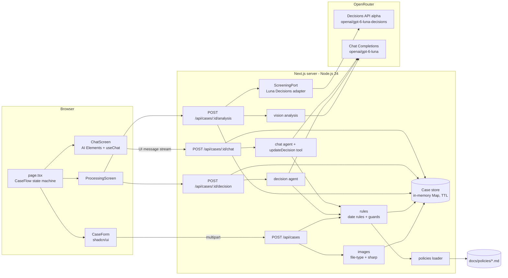
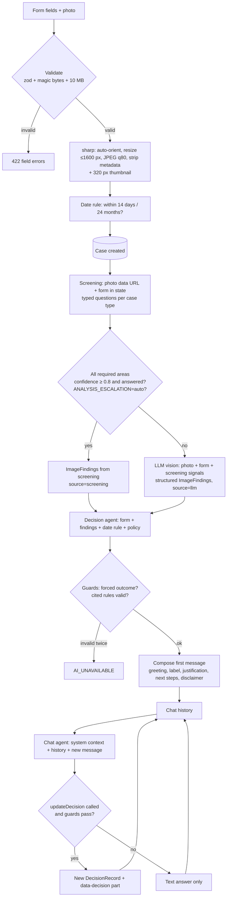
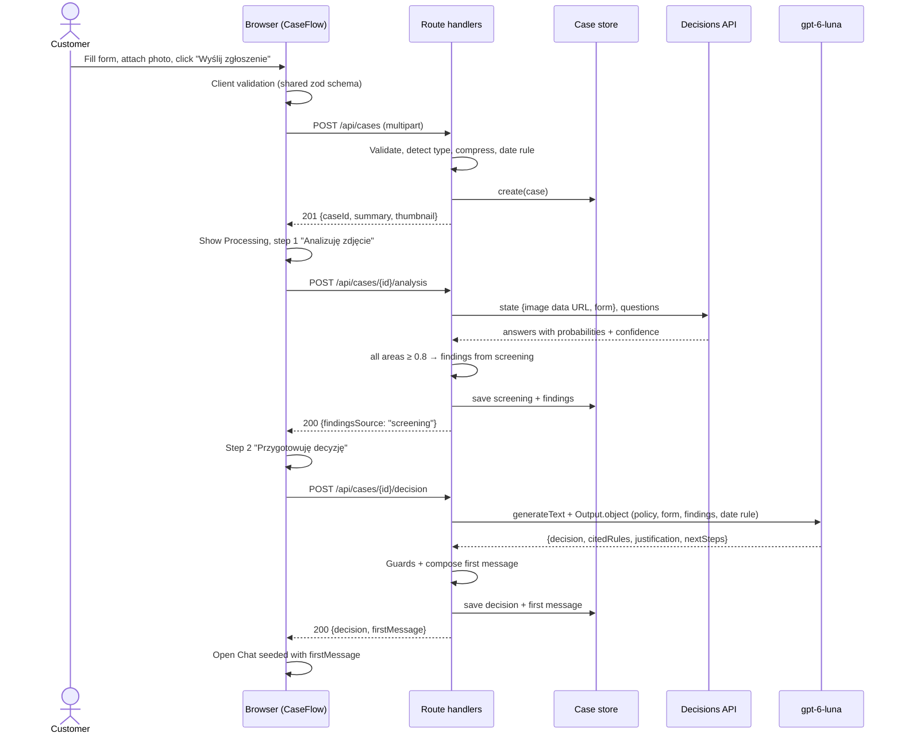
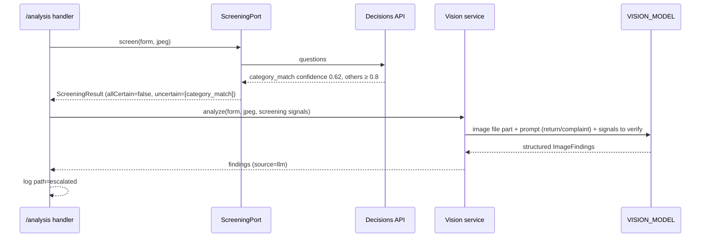
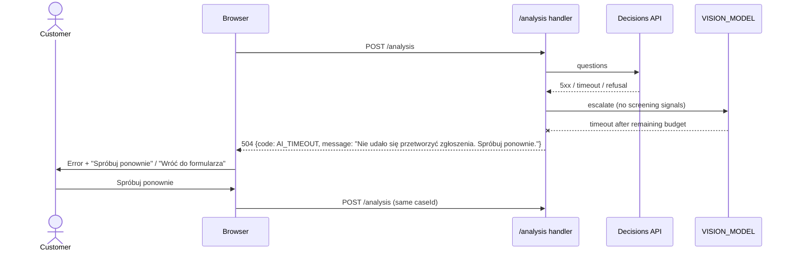
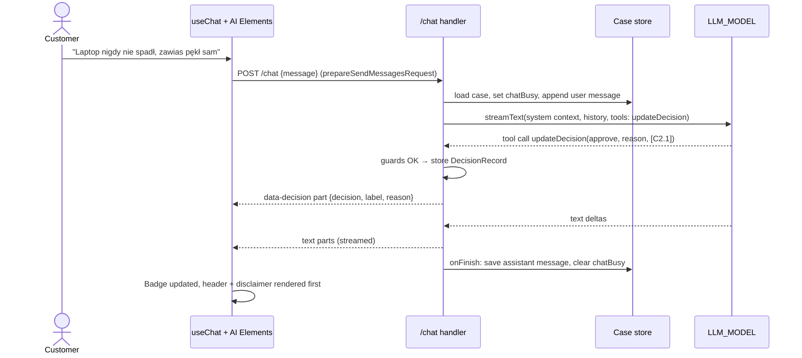

# ADR: Hardware Service Decision Copilot — Main Architecture

**Date:** 2026-11-25
**Status:** Accepted
**PRD:** [`docs/PRD.md`](../PRD.md)
**Amended by:** [ADR-005](005-amendments.md): A1, A2, A3, A7, A8, A9, A12, A14, A19. Where this ADR differs, ADR-005 wins.

---

## 1. Overview

This ADR set defines how to build the PoC described in `docs/PRD.md`: a Polish-language self-service web app where a customer submits a return or complaint form with one photo, receives a preliminary policy-based decision (Approve / Reject / Manual review) and continues in a streaming chat with the agent.

The PRD defines *what* the product does. This ADR set defines *how*: stack, project initialization, AI pipeline (including the Luna Decisions pre-screening stage requested after the PRD), endpoints, UI components, data models and testing. It also records an evaluation of the options the team considered (AI SDK, Chat SDK, OpenRouter Responses API, OpenRouter AI SDK provider, AI Elements, assistant-ui).

| File | Area |
|---|---|
| `000-main-architecture.md` | System overview, stack, option evaluation, cross-cutting decisions, diagrams, test strategy |
| `001-project-setup.md` | Initializing the empty `app/` folder: Next.js, TypeScript strict, pnpm, shadcn/ui, AI Elements, test tooling |
| `002-ai-pipeline.md` | Screening (Luna Decisions), escalation to multimodal LLM, decision agent, chat agent, prompts, policies, guards |
| `003-backend-api.md` | Route handlers, case store, image validation and compression, error handling |
| `004-frontend.md` | Screens, client state machine, form, processing screen, chat with AI Elements + `useChat` |
| `005-amendments.md` | Resolutions from the 2026-11-26 consistency review; takes precedence over 000–004 |

**Research date:** all library facts were checked on 2026-11-25 with Context7 and the vendors' pages. Items marked **VERIFY** were not confirmed and must be checked in the spikes listed in Section 8.10 before the dependent code is written.

---

## 2. Technology Documentation References

| Library | Context7 ID or official docs | Verified version (2026-11-25) | Used for |
|---|---|---|---|
| AI SDK core (`ai`) | `/vercel/ai` (tracks `main` = v7) | 7.0.x | `streamText`, `generateText` + `Output.object`, `createUIMessageStream`, `convertToModelMessages`, tools, test mocks |
| AI SDK React (`@ai-sdk/react`) | `/vercel/ai` | 4.0.x | `useChat`, `DefaultChatTransport` |
| OpenRouter AI SDK provider (`@openrouter/ai-sdk-provider`) | `/openrouterteam/ai-sdk-provider` | 3.1.x (peer `ai ^7`, Node 22+, ESM-only) | Chat Completions models, `decisionModel()` for the Decisions API |
| OpenRouter API docs | https://openrouter.ai/docs | — | Decisions API, image inputs, structured outputs, errors, provider routing |
| OpenRouter Decisions API | https://openrouter.ai/docs/guides/features/decisions.md, https://openrouter.ai/docs/guides/community/multimodal-decisions.md | alpha | Luna Decisions screening |
| Next.js | `/vercel/next.js/v16.4.5` | 16.4.x | App Router, route handlers, `create-next-app` |
| AI Elements | `/vercel/ai-elements` | 1.9.x | Chat UI components (Conversation, Message, MessageResponse, PromptInput, Loader) |
| assistant-ui (evaluated, not chosen) | `/assistant-ui/assistant-ui` | `@assistant-ui/react` 0.15.x, `@assistant-ui/ai-sdk` 0.0.x | Alternative chat UI |
| shadcn/ui CLI | `/shadcn-ui/ui` | 4.23.x | Base UI components, required by AI Elements |
| Tailwind CSS | https://tailwindcss.com/docs | 4.x | Styling, design tokens |
| zod | https://zod.dev | 4.x | Shared validation schemas, structured output schemas |
| sharp | `/lovell/sharp/v0.35.5` | 0.35.x | Image auto-orient, resize, re-encode, metadata strip |
| file-type | `/sindresorhus/file-type` | 22.x (ESM-only) | Image format detection from magic bytes |
| Vitest | https://vitest.dev | latest | Unit, component and integration tests |
| Testing Library | https://testing-library.com/docs/react-testing-library/intro | latest | Component tests |
| Playwright | https://playwright.dev/docs/intro | latest | E2E tests on the real stack, manual QA via CLI |

Note: the Context7 index `/websites/ai-sdk_dev` only covers AI SDK up to v6. Use `/vercel/ai` and compare with `pnpm view ai dist-tags`.

---

## 3. System Architecture

### Architecture pattern
A single **Next.js App Router monolith**. The browser UI and the server API live in one project and one Node.js process. The API uses route handlers. There is no separate backend service and no database: case state is kept in server memory (decision in Section 8.4). The app runs locally on the course VM only.

### Repository structure
- `app/` is the Next.js project root. It has its own `package.json`, `pnpm-lock.yaml` and nested `app/AGENTS.md`, created by `create-next-app` (see ADR-001).
  - `app/src/app/` holds routes: one page (`/`) and the API route handlers under `/api/cases/...`.
  - `app/src/components/` holds UI components:
    - `ui/` for shadcn
    - `ai-elements/` for AI Elements
    - `case/` for app screens
  - `app/src/lib/` holds code shared by client and server: zod schemas, enums, Polish UI strings, decision labels.
  - `app/src/server/` is server-only code. Every module starts with the `server-only` guard.
    - `cases/`: case store and services
    - `images/`: validation and compression
    - `ai/`: model registry, screening adapter, vision analysis, decision agent, chat agent, prompts
    - `policies/`: policy loader and rule-ID parser
    - `rules/`: deterministic date rules and decision guards
  - `app/tests/` holds integration tests, E2E tests, fixtures and recorded captures.
- `docs/policies/*.md` holds the policy documents, the single source of truth. The app reads them at startup through `POLICY_DIR`.
- `assets/` holds brand tokens, fonts, logo and example images used in tests.

### Technology stack

| Layer | Technology | Reason |
|---|---|---|
| Runtime | Node.js 24 (installed on the VM; the provider needs ≥22) | Required by the OpenRouter provider and sharp |
| Package manager | pnpm via Corepack | Chosen by the team; supported by `create-next-app` and shadcn |
| Framework | Next.js 16 App Router, TypeScript `strict` | Required by the brief; route handlers and UI in one project |
| UI | React 19, Tailwind CSS 4, shadcn/ui, AI Elements | AI Elements sits directly on `useChat`, renders streaming Markdown, and its components are copied into the repo so we control them |
| Chat state | `useChat` from `@ai-sdk/react` with `DefaultChatTransport` | Official streaming client for AI SDK UI message streams |
| AI orchestration | AI SDK 7 (`ai`) | Streaming, structured output, tools and test mocks in one SDK |
| Model access | OpenRouter through `@openrouter/ai-sdk-provider` | The brief requires OpenRouter (`OPENROUTER_API_KEY`); the provider covers both chat models and the Decisions API |
| Screening model | `openai/gpt-6-luna-decisions` (Decisions API, alpha) | Typed answers with calibrated probabilities and a `confidence` value per question; accepts up to 128 images |
| Vision / decision / chat model | `openai/gpt-6-luna` (`LLM_MODEL`) | Model in `.env.example`; supports `reasoning`, `response_format`, `tools` and `stream`. Image input is **VERIFY** (S2) |
| Validation | zod 4 | One schema for client form, server request and structured output |
| Image processing | sharp + file-type | Server-side compression (PRD AC-16) and format detection from content (AC-08) |
| Persistence | In-memory case store with TTL | PRD: reloading clears the case; no DB in the PoC |
| Tests | Vitest, Testing Library, AI SDK `ai/test` mocks, Playwright | Unit, integration and E2E layers as required by `AGENTS.md` |

---

## 4. Module Structure & Dependencies

| Module | Responsibility | Depends on | Used by |
|---|---|---|---|
| `lib/schemas` | zod schemas: case form, case type, category, decision enum, API error shape | zod | UI, route handlers, server services |
| `lib/i18n-pl` | All Polish UI strings, decision labels, error messages | — | UI, server (error messages, decision labels in the first message) |
| `server/config` | Reads and validates environment variables at startup (fails fast on missing `OPENROUTER_API_KEY`) | zod | All server modules |
| `server/images` | Size check, magic-byte detection, compression, thumbnail | sharp, file-type | `server/cases` |
| `server/policies` | Loads `return-policy.md` and `complaint-policy.md` and extracts the set of valid rule IDs (`R1.1`, `C3.1`, …) | config | AI decision/chat, guards |
| `server/rules` | Deterministic date rules (14 days / 24 months) and decision guards (forced outcomes, cited-rule validation) | policies, schemas | AI decision/chat services |
| `server/ai/models` | Builds OpenRouter model instances from env (decision model, vision model, chat model) | provider, config | AI services |
| `server/ai/screening` | Luna Decisions adapter behind a `ScreeningPort` interface: builds questions, calls the API, maps answers, decides "certain or not" per area | models, schemas | `server/cases` (analysis) |
| `server/ai/vision` | Escalated image analysis with the multimodal LLM and structured output | models, prompts | `server/cases` (analysis) |
| `server/ai/decision` | First decision with structured output, guard validation, composing the first message | models, prompts, rules, policies | `server/cases` (decision) |
| `server/ai/chat` | Chat streaming, system prompt assembly, `updateDecision` tool | models, prompts, rules, policies | chat route handler |
| `server/ai/prompts` | Prompt templates as Markdown files, one per stage and case type | — | AI services |
| `server/cases` | In-memory case store and the services that run each pipeline stage | images, ai/*, rules | route handlers |
| `app/api/...` | HTTP layer: parse request, call service, map errors to HTTP | server/cases, lib | browser |
| `components/case` | Form, processing, chat screens and the client state machine | lib, ui, ai-elements, `@ai-sdk/react` | `app/page.tsx` |

Dependency direction: `components → lib`, `app/api → server/cases → server/{ai, images, rules} → server/{policies, config} → lib`. `lib` imports nothing from `server`. Client components never import `server/*` (enforced by `server-only`). There are no circular dependencies.

---

## 5. Data Models

All models live in server memory unless stated otherwise. Full field lists are in ADR-002 and ADR-003. The overview:

| Model | Purpose | Key fields | Persistence |
|---|---|---|---|
| **CaseForm** | Validated form input | `caseType` (`return` \| `complaint`), `category` (9-value enum), `productName` (2–100 chars), `purchaseDate` (ISO date), `reason` (≤2000; ≥10 for complaint) | Part of Case |
| **StoredImage** | Compressed photo for AI | JPEG bytes, width, height, detected original MIME, original byte size | Part of Case, memory only |
| **DateRuleResult** | Deterministic period check | `withinPeriod`, `daysSincePurchase`, `ruleId` (`R1.1` or `C1.1`), `referenceDate` | Part of Case |
| **ScreeningResult** | Luna Decisions output | per-area answers (value, probabilities, `confidence`, `certain`), `refusedAreas`, `allCertain`, `costCredits`, `durationMs` | Part of Case |
| **ImageFindings** | Normalized image facts used by the decision agent | `source` (`screening` \| `llm`), `photoUsable`, `usabilityIssue`, `categoryMatch`, `damageVisible`, `damageType`, `damageLocation`, `likelyCause`, `signsOfUse`, `resellable`, `conditionScore` (0–4), `notes` | Part of Case |
| **DecisionRecord** | One decision (initial or chat update) | `decision` (`approve` \| `reject` \| `manual_review`), `citedRules[]`, `justification`, `nextSteps[]`, `forcedBy` (`date_rule` \| `unusable_photo` \| `category_mismatch` \| null), `origin` (`initial` \| `chat_update`), `createdAt` | Part of Case (current + history) |
| **Case** | Aggregate root | `id` (UUID v4), `createdAt`, `expiresAt`, `status` (`created` → `analyzed` → `decided`), form, image, thumbnail data URL, date rule, screening, findings, current decision, decision history, chat messages (`UIMessage[]`), `chatBusy` | In-memory Map, TTL 120 min, max 500 cases, oldest evicted first |

The client keeps its own copy of the form values, the thumbnail and `useChat` messages in React state only. Reloading the page clears them (PRD AC-32).

---

## 6. API / Interface Contracts

All endpoints are same-origin route handlers. There is no auth (PRD Out of Scope). Errors use one JSON shape: `{ error: { code, message } }`, where `message` is a Polish user-facing text with no technical details (PRD AC-36). Details are in ADR-003.

| # | Method & path | Input | Output | Purpose / PRD step |
|---|---|---|---|---|
| 1 | `POST /api/cases` | `multipart/form-data`: form fields + `photo` file | `201 { caseId, summary, thumbnailDataUrl }`; `422` with field errors; `413` | Validate, detect format, compress, compute date rule, create case. No AI call |
| 2 | `POST /api/cases/{caseId}/analysis` | none | `200 { findingsSource, photoUsable }` | "Analizuję zdjęcie": Luna Decisions screening, escalating to the multimodal LLM when needed. Idempotent |
| 3 | `POST /api/cases/{caseId}/decision` | none | `200 { decision, decisionLabel, citedRules, firstMessage: UIMessage }` | "Przygotowuję decyzję": decision agent, guards, first message. Idempotent |
| 4 | `POST /api/cases/{caseId}/chat` | JSON `{ message: UIMessage }` (only the newest user message; may include `trigger`) | AI SDK UI message stream (SSE) with text parts and `data-decision` parts | Chat with full server-side context; decision updates through a tool |

Common errors: `404 CASE_NOT_FOUND` (unknown or expired case), `409 CASE_STATE` (stage called out of order, or a chat request while another is running), `502 AI_UNAVAILABLE`, `504 AI_TIMEOUT`.

---

## 7. Environment Variables

| Variable | Purpose | Required | Example value |
|---|---|---|---|
| `OPENROUTER_API_KEY` | OpenRouter API key, server-only | Yes | `sk-or-v1-…` |
| `LLM_MODEL` | Model for the decision agent and chat (reasoning) | Yes | `openai/gpt-6-luna` |
| `VISION_MODEL` | Multimodal model for escalated image analysis; defaults to `LLM_MODEL` | No | `openai/gpt-6-luna` |
| `DECISIONS_MODEL` | Luna Decisions model for screening | No (default shown) | `openai/gpt-6-luna-decisions` |
| `SCREENING_CONFIDENCE_THRESHOLD` | Minimum `confidence` for an area to count as certain | No | `0.8` |
| `ANALYSIS_ESCALATION` | `auto` (escalate only when needed) or `always` (always run LLM vision, for comparison during the course) | No | `auto` |
| `POLICY_DIR` | Folder with policy Markdown files, relative to `app/` | No | `../docs/policies` |
| `CASE_TTL_MINUTES` | Case lifetime in memory | No | `120` |
| `APP_TIME_ZONE` | Time zone for the date rules | No | `Europe/Warsaw` |

`.env.example` in the repo root must be extended with the optional variables during setup (ADR-001). `app/.env.local` holds the real values and is gitignored.

---

## 8. Technical Decisions

### 8.1 Build on AI SDK 7 + OpenRouter AI SDK provider (Chat Completions)
**Status:** Accepted
**Date:** 2026-11-25
**Context:** The brief asks us to compare the AI SDK with the OpenRouter Responses API, the OpenRouter AI SDK provider and Chat SDK, and to recommend one approach. We need streaming chat, image input, structured output, tools, a React client and testability.
**Decision:**
- Use **AI SDK 7** (`ai`, `@ai-sdk/react`) with **`@openrouter/ai-sdk-provider` 3.x** as the model provider.
- `streamText` + `useChat` handle the chat.
- `generateText` with `Output.object` handles structured stages.
- The provider's `decisionModel()` handles the Decisions API (Section 8.3).
- The provider calls OpenRouter's Chat Completions endpoint. That is enough for every PRD feature.

**Option evaluation:**

| Option | What it is (verified 2026-11-25) | Fit for this PRD | Verdict |
|---|---|---|---|
| AI SDK 7 (`ai` + `@ai-sdk/react`) | TypeScript toolkit: `streamText`, `generateText`/`Output`, tools, UI message streams, `useChat`, test mocks | Covers streaming chat, multimodal file parts, structured output, tools and data parts for decision updates | **Chosen** |
| OpenRouter AI SDK provider | Official provider package, v3 targets AI SDK v7; exposes chat models, reasoning options, usage accounting and `decisionModel()` | Connects AI SDK to `OPENROUTER_API_KEY` and both models in `.env.example` with no custom HTTP code | **Chosen** (with AI SDK) |
| OpenRouter Responses API (direct) | Stateless, OpenAI-compatible `/api/v1/responses`; full history sent each call; `input_image`, `text.format` JSON schema, tools | Works, but the provider does not use it, so we would hand-write HTTP, SSE parsing and the conversion to `useChat`'s stream protocol. Being stateless brings no benefit over Chat Completions, because we keep history ourselves either way | Rejected |
| chat-sdk.dev | Now a multi-platform **bot SDK** (Slack, Teams, Discord, Telegram, WhatsApp, Web adapter, Redis/Postgres state), no longer a Next.js template | Solves multi-channel bots. We need one web form plus chat | Rejected |
| `vercel/chatbot` (former "AI Chatbot" template) | Full Next.js app with Auth.js, Neon Postgres, Vercel Blob, Redis, AI Gateway, artifacts | Brings auth, a DB, Blob and a gateway that the PRD puts out of scope or does not need. Removing them costs more than building our 1 page + 4 routes | Rejected |

**Consequences:**
- (+) One SDK for every stage. The official test mocks (`MockLanguageModelV4`) make TDD possible without network calls.
- (+) `useChat` and AI Elements work with the stream protocol directly.
- (-) AI SDK v7 is recent. Many web examples are v5/v6 (`toUIMessageStreamResponse`, `generateObject`) and are deprecated. Agents must use Context7 `/vercel/ai`.
- (-) The provider is ESM-only and needs Node 22+.

**Review trigger:** The provider gains Responses API support that we need (e.g. async tools), or OpenRouter deprecates Chat Completions for the chosen models.

### 8.2 Pipeline: screening → conditional escalation → decision → chat
**Status:** Accepted
**Date:** 2026-11-25
**Context:** After the PRD was written, the team asked for a first stage with the Luna Decisions model:
- It classifies the photo and form: category match, damage, condition, usability.
- It returns a confidence value per area.
- Below a threshold (0.8), the case is escalated to the multimodal LLM.
- With high confidence, the LLM image analysis is skipped.

The team chose to skip only the LLM image analysis. The decision agent always runs.

**Decision:** Four stages. Full specification in ADR-002.
1. **Screening.** Luna Decisions gets the compressed photo and the form data, and answers typed questions for each case type.
2. **Escalation.** The multimodal LLM runs when any of these is true:
   - any required area has `confidence < SCREENING_CONFIDENCE_THRESHOLD`
   - an area was refused or missing
   - the screening call failed
   - `ANALYSIS_ESCALATION=always`

   The LLM receives the screening answers as signals to verify. If none of these apply, ImageFindings are derived from the screening answers alone.
3. **Decision.** The reasoning model (`LLM_MODEL`) returns a structured decision from form data, ImageFindings, the date rule result and the policy for the case type. Server guards validate it, and the server composes the first message.
4. **Chat.** `streamText` with the full case context and an `updateDecision` tool.

**Rejected alternatives:**
- Skip the LLM entirely on the fast path and build the decision from rules and a template: rejected by the team. It cannot write case-specific justifications that cite rules (PRD AC-19, AC-25).
- Always run the LLM vision step (no screening): this ignores the requested experiment. It is kept as `ANALYSIS_ESCALATION=always` so both paths can be compared.

**Consequences:**
- (+) Clear cases are cheaper and faster.
- (+) Confidence values give a measurable escalation signal.
- (+) Every case logs its path, so the team can judge whether screening alone is enough.
- (-) Depends on an **alpha** API whose shape may change. It is isolated behind `ScreeningPort` and recorded captures.
- (-) "Calibrated" probabilities are claimed in the docs, but no calibration metrics are published.

**Review trigger:**
- Escalation rate above 70% or below 5% over 30 manual test cases: adjust the questions or the threshold.
- Decisions API leaves alpha or changes shape.

### 8.3 Call Luna Decisions through the provider's `decisionModel()`, behind an adapter
**Status:** Accepted (implementation detail confirmed by spike S1)
**Date:** 2026-11-25
**Context:**
- `openai/gpt-6-luna-decisions` is not a Chat Completions model, so `generateText`/`streamText` cannot call it.
- It is served by `POST /api/alpha/decisions` with `model`, `state`, `questions` (`noul`, `choice`, `score`) and optional `assets`.
- Images must be base64 **data URLs** (png/jpeg/webp). Remote URLs are rejected by the OpenAI adapter.
- The OpenRouter provider exposes `openrouter.decisionModel()`, but the AI SDK function that invokes it was not found in the docs.

**Decision:** Define a `ScreeningPort` interface in `server/ai/screening`: input is the case form and the JPEG bytes, output is a ScreeningResult. Its default adapter uses `openrouter.decisionModel(DECISIONS_MODEL)` the way the provider docs describe. If spike S1 shows that path does not work, the adapter calls `POST https://openrouter.ai/api/alpha/decisions` directly with `fetch`, using the same key. Nothing outside the adapter knows which path is used.
**Rejected alternatives:**
- Ask the chat LLM for a JSON "confidence" field: these self-reported numbers are not calibrated, and the team explicitly asked for Luna Decisions.
- Use logprobs from `gpt-6-luna`: `logprobs` is not in its supported parameters.

**Consequences:**
- (+) Swapping the transport touches one file.
- (+) Tests mock the port with recorded responses.
- (-) Two possible transports. The spike must settle it before implementation.

**Review trigger:** The AI SDK documents a stable decision API, or the alpha endpoint changes.

### 8.4 Server-side in-memory case store; client sends only `caseId` + new message
**Status:** Accepted
**Date:** 2026-11-25
**Context:**
- The chat agent needs the full context: form, findings, first decision and history (PRD AC-29).
- The PRD forbids persistence across reloads.
- If the client sent the whole context, it could tamper with the image analysis or the decision.

**Decision:**
- The server keeps a `Map<caseId, Case>` with a 120-minute TTL and a cap of 500 cases (oldest evicted).
- The map is stored on `globalThis` so it survives dev hot reload.
- The chat transport sends only the newest user message. The server rebuilds the model input from the stored case.

**Rejected alternatives:**
- Client-held context: the client could tamper with it, and the request grows with every message.
- SQLite now: persistence is out of scope in the PRD. It is planned as a later feature.

**Consequences:**
- (+) Authoritative context on the server.
- (+) Small requests.
- (+) Works with `useChat` via `prepareSendMessagesRequest`.
- (-) Restarting the server loses open cases. The UI shows "case expired" and offers a new case.
- (-) Single process only. This is acceptable because deployment is local only.

**Review trigger:** Moving to serverless/multi-instance deployment, or implementing the "save sessions" feature. Replace the store with SQLite behind the same `CaseRepository` interface.

### 8.5 Deterministic date rules and decision guards override the model
**Status:** Accepted
**Date:** 2026-11-25
**Context:**
- PRD AC-20 and AC-21 require a deterministic Reject for out-of-period cases.
- AC-22 requires Manual review for unusable or mismatched photos.
- AC-19 requires citing real rule IDs.

LLMs make date arithmetic and rule citation mistakes.

**Decision:**
- Date rules are computed in code (calendar days in `APP_TIME_ZONE`) when the case is created.
- After the decision model responds, guards force the outcome where a rule applies:
  - out of period → `reject` + `R1.1`/`C1.1`
  - photo certainly unusable or category mismatch → `manual_review`
- Guards also check that `citedRules` is a non-empty subset of the IDs parsed from the policy.
- On an invalid response, the call is retried once. Then the stage fails with `AI_UNAVAILABLE`.
- The same guards apply to `updateDecision` in the chat.

**Rejected alternatives:** Prompt-only enforcement. It cannot be unit-tested and is not reliable.
**Consequences:**
- (+) AC-19 to AC-22 hold whatever the model outputs.
- (+) Fast unit tests.
- (-) Policy period values (14 days, 24 months) are duplicated in code and in the policy text. A unit test checks the policy file still contains them.

**Review trigger:** Policies become editable by staff, or more deterministic rules are added.

### 8.6 First decision as structured output; server composes the first message
**Status:** Accepted
**Date:** 2026-11-25
**Context:**
- PRD AC-25 fixes the order: greeting, label, justification, numbered next steps, disclaimer.
- AC-30 needs a machine-readable decision for the summary label.
- AC-23 keeps the processing screen open until the message is ready, so streaming the first message brings no UX benefit.

**Decision:**
- The decision stage uses `generateText` with `Output.object`: decision, citedRules, justification (Markdown), nextSteps, greetingLine.
- The server renders the first assistant message as one Markdown text part in the fixed order. It adds the Polish decision label and the fixed disclaimer from `lib/i18n-pl`.
- The decision travels as message metadata.

**Rejected alternatives:**
- Stream free text and parse the label: the parsing is fragile and AC-25 order is not guaranteed.
- `generateObject`: deprecated in AI SDK 7.

**Consequences:**
- (+) Exact format.
- (+) The disclaimer is never missing.
- (+) Easy to unit-test.
- (-) No token streaming for the first message. That is acceptable under AC-23.

**Review trigger:** The PRD changes to show the decision while it is being generated.

### 8.7 Chat decision updates through a server-validated tool and `data-decision` parts
**Status:** Accepted
**Date:** 2026-11-25
**Context:** In the chat, the agent may revise the decision when there are new facts (PRD 4.5, AC-30). The summary label must update, and the message must start with "Zaktualizowana decyzja: …" plus the disclaimer.
**Decision:**
- The chat agent has one tool, `updateDecision` (decision, reason, citedRules).
- The system prompt requires calling it before writing any text, and only when new facts justify a change.
- Its `execute` runs the guards. If it accepts the update, it stores a new DecisionRecord and writes a `data-decision` UI part: decision, label, reason, and a disclaimer flag. If it rejects the update, it returns a refusal reason to the model.
- The UI renders a `data-decision` part as the first block of the message ("Zaktualizowana decyzja: X" + disclaimer), then the text parts. It also updates the summary badge.

**Rejected alternatives:** Asking the model to write the header text and regex-parsing it. This is fragile, and the guards cannot be enforced.
**Consequences:**
- (+) Decision changes are validated and auditable.
- (+) The label, header and disclaimer are deterministic.
- (-) It relies on the model calling the tool. The prompt and integration tests cover this, and a missing call simply leaves the decision unchanged, which is safe.

**Review trigger:** Updates arrive without a tool call in more than 1 of 10 manual test conversations where they were justified.

### 8.8 AI Elements for the chat UI (over assistant-ui)
**Status:** Accepted
**Date:** 2026-11-25
**Context:** The brief asks for ready chat components with built-in streaming. Two candidates: AI Elements (Vercel, shadcn registry) and assistant-ui.

**Decision:** Use **AI Elements** components on top of `useChat`: Conversation, Message, MessageContent, MessageResponse, PromptInput, Loader. The other screens use shadcn/ui components.

| Criterion | AI Elements | assistant-ui |
|---|---|---|
| Integration with `useChat` (AI SDK 7) | Direct: we render `messages[].parts` ourselves | Through its own runtime (`useChatRuntime` from `@assistant-ui/ai-sdk` 0.0.x, very young for v7) |
| Seeded first message, custom `data-decision` part, `prepareSendMessagesRequest` | Native `useChat` options | Has to go through the runtime layer; not verified for v7 |
| Ownership | Source copied into `src/components/ai-elements/` | Library dependency + generated components |
| Features we do not need | Few | Thread list, branching, editing (PRD: one case, no edit) |
| Setup risk | Needs shadcn + Tailwind 4 (we use both) | `assistant-ui init` exits if `components.json` already exists |

**Consequences:**
- (+) Full control over parts rendering and Polish texts.
- (+) Markdown streaming via MessageResponse (PRD AC-26).
- (-) We write the small state glue ourselves.

**Review trigger:** Thread history, branching or message editing becomes a requirement.

### 8.9 Two-step processing with plain JSON requests; streaming only in chat
**Status:** Accepted
**Date:** 2026-11-25
**Context:**
- The processing screen shows two steps (PRD AC-23).
- The PRD allows 60 s per AI step (AC-34).
- "Try again" repeats processing without re-entering data.

**Decision:**
- The client calls `POST /analysis` and then `POST /decision`. These are separate, idempotent JSON requests, and each maps to one visible step with its own 60 s budget.
- "Spróbuj ponownie" repeats the failed step. A completed stage returns its stored result.
- Only the chat uses the UI message stream.

**Rejected alternatives:** A single streaming endpoint with transient `data-progress` parts. It works, but it needs a second stream consumer outside `useChat` and makes per-step retry and timeout harder.
**Consequences:**
- (+) Simple to test.
- (+) Retry per step.
- (+) Clear timeouts.
- (-) One extra HTTP round trip, which is negligible.

**Review trigger:** More than 3 pipeline steps, or progress inside a step is needed.

### 8.10 Mandatory verification spikes before implementation
**Status:** Accepted
**Date:** 2026-11-25
**Context:** Some facts could not be verified on 2026-11-25. The `gpt-6-luna-decisions` model page returned 404. `gpt-6-luna` lists neither image input nor `structured_outputs`. `AGENTS.md` requires mocks to come from real captures.
**Decision:** Before the dependent code, the implementing agent runs these spikes. Results go to `app/tests/fixtures/captures/`, as the verbatim response with date, target, model and request, and no secrets.

| Spike | Question | Outcome that changes the design |
|---|---|---|
| S1 | Luna Decisions with one image + questions via `decisionModel()`; shape of `confidence`/probabilities; refusals; `usage.cost` | `decisionModel()` unusable → direct `fetch` adapter (8.3) |
| S2 | Does `openai/gpt-6-luna` accept an image part, and does it honour a JSON schema (`response_format`, `provider.require_parameters: true`)? | No image support → set `VISION_MODEL` to a vision-capable OpenRouter model chosen with the user. No schema support → use the provider's `response-healing` plugin on non-streaming calls, plus zod validation |
| S3 | A 10 MB multipart upload to a Next.js 16 route handler in `dev` and `start` | Body limit hit → document the config needed |
| S4 | `useChat` seeded with `messages` + `prepareSendMessagesRequest`; AI Elements PromptInput Enter / Shift+Enter behaviour | Behaviour differs → adapt component props (ADR-004) |

**Consequences:**
- (+) No invented response shapes.
- (-) Costs about 1 hour and a few cents of credits.

**Review trigger:** None. This is a one-time gate.

### 8.11 Data handling and logging
**Status:** Accepted
**Date:** 2026-11-25
**Context:** Customer photos may contain personal data (faces, addresses on labels).
**Decision:**
- sharp strips all metadata, including EXIF/GPS.
- Photos and free-text fields are never logged.
- Each stage logs one JSON line with case ID, stage, duration, model, path (`fast` | `escalated`), per-area confidences, decision and `usage.cost`.
- All OpenRouter calls send `provider.data_collection: "deny"`. If spike S1 or S2 shows this removes every provider for a model, record that and drop the setting for that model.
- `OPENROUTER_API_KEY` is read only in `server/config`, never sent to the client, never logged.

**Consequences:**
- (+) Logs are enough to evaluate the screening experiment.
- (-) `data_collection: deny` may reduce provider choice.

**Review trigger:** Real customer data is introduced (not allowed in the PoC).

---

## 9. Diagrams

### 9.1 Architecture / Component Diagram

### 9.2 Data Flow Diagram

### 9.3 Sequence Diagrams

#### Form submission, analysis (fast path) and decision

#### Escalated analysis (low confidence)

#### Screening failure falls back to LLM; LLM failure shows retry

#### Chat message with decision update (streaming)

---

## 10. Testing Strategy

### Philosophy
TDD, as `AGENTS.md` requires. Start from the PRD ACs and this ADR. Write each failing test first, then implement the minimum code. Mocks must come from real captures (spikes S1/S2). Model outputs are non-deterministic, so automated tests assert **structure and guard behaviour**, not wording. Live model behaviour is checked by E2E and manual QA on `assets/example-images/`. These are real photos: never tell the model what they show, and never assert a specific visual verdict.

### Test layers

| Layer | Type | Scope | Tools |
|---|---|---|---|
| Unit | Pure logic, all deps mocked | Schemas, image validation/compression, date rules, guards, policy parser, screening answer mapping and gating, first-message composer, case store TTL/eviction, prompt assembly | Vitest |
| Component | UI behaviour in jsdom | Form ACs (AC-01…AC-12), processing states, chat rendering of parts and the `data-decision` block, new-case dialog | Vitest + Testing Library |
| Integration | Route handlers called with real `Request` objects; only external AI mocked | Full pipeline per endpoint with `MockLanguageModelV4` and a `ScreeningPort` fake fed by captures; error mapping; idempotency; chat streaming protocol | Vitest, `ai/test` |
| E2E | Real stack, real OpenRouter, nothing mocked | Form → processing → chat on example images; deterministic rejection by date; validation errors; new case | Playwright (`pnpm test:e2e`, run manually because it costs credits) |
| Manual QA | Human-like run with Playwright CLI + screenshots | Every touched screen vs `assets/homepage.png` and `docs/design-guidelines.md` | Playwright CLI |

### Key test scenarios
1. **Happy path return.** `phone-1.jpg`, return, purchase 3 days ago. Expected: 201 → analysis 200 → decision 200 with a decision from the enum, at least one valid `R*` rule, first message in AC-25 order, disclaimer present.
2. **Deterministic date reject.** Return with purchase 30 days ago, and a complaint with purchase 25 months ago. Expected: `reject`, `forcedBy=date_rule`, citedRules includes `R1.1`/`C1.1`, even when the mocked model returns `approve`.
3. **Escalation gating.** Screening fake with one area at confidence 0.79. Expected: vision service called and `findingsSource=llm`. All areas at ≥0.80: vision not called (`auto`). With `always`: called.
4. **Refusal or missing answer.** Treated as uncertain, so the case escalates.
5. **Screening outage.** Port throws, so the case escalates. Vision also throws → 502/504 with a Polish message and no technical text.
6. **Unusable photo.** Findings `photoUsable=false` with certainty. Expected: decision forced to `manual_review`.
7. **Invalid cited rule.** The model cites `R9.9`. Expected: one retry, then `AI_UNAVAILABLE` if it is still invalid.
8. **File validation.** `laptop-1.png` (JPEG bytes, `.png` name) accepted. A text file renamed `.jpg` → 422 format error. A file over 10 MB → 413/422 size error. Output JPEG has a longer side ≤1600 px and no EXIF.
9. **Chat context.** The mock model receives a system prompt containing form data, findings, decision and policy, plus the full history. Expected: assistant message saved, `chatBusy` cleared.
10. **Chat decision update.** The mock emits an `updateDecision` tool call. Expected: a `data-decision` part in the stream and the case decision updated. The guard rejects `approve` when the date rule failed.
11. **Chat retry idempotency.** The same user message ID sent twice is stored once.
12. **Concurrency and state.** A second chat request while busy → 409. `/decision` before `/analysis` → 409. Unknown case → 404.

### Technical acceptance criteria
- TAC-01: `pnpm typecheck` (`tsc --noEmit` with `strict: true`), `pnpm lint` and `pnpm test` pass with 0 errors and 0 warnings introduced by the change.
- TAC-02: No client bundle contains `OPENROUTER_API_KEY` or any `server/*` module (`server-only` guard on every server module).
- TAC-03: Every recorded capture used by a mock exists in `app/tests/fixtures/captures/` with date, target, model, request and no secrets.
- TAC-04: The images sent to any model are JPEG, have a longer side ≤1600 px and contain no EXIF/GPS metadata (unit test reads metadata back).
- TAC-05: Every stage writes one structured log line with case ID, stage, durationMs, model, path and decision, and no image data or free text.
- TAC-06: With the AI services mocked, `POST /api/cases` responds in < 1 s for a 10 MB image on the course VM.
- TAC-07: No AI SDK API deprecated in v7 is used (`toUIMessageStreamResponse`, `generateObject`, `streamObject`, `image` content parts). A lint rule or grep check runs in CI.

---

## 11. Open Questions and Assumptions

- **Return window boundary:** the ADR reads "within 14 calendar days" as `today − purchaseDate ≤ 14` days, so a purchase on 1 Nov can be returned until 15 Nov inclusive. Return Policy R1.2 ("day 15 or later") could also be read with the purchase day counted as day 1, which ends the window one day earlier. Confirm with the business owner. Only the `DateRules` constant changes.
- **Vision model:** if spike S2 shows that `openai/gpt-6-luna` does not accept images, the team chooses `VISION_MODEL`. No other design change follows.
- **Decisions API stability:** alpha. If its shape changes, only the `ScreeningPort` adapter and its captures change.
- **Screening calibration:** the 0.8 threshold is the team's initial value. Tune it after manual QA using the per-case log lines (escalation rate, disagreements reported by the vision model in `always` mode).
