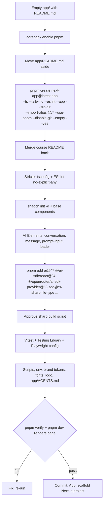
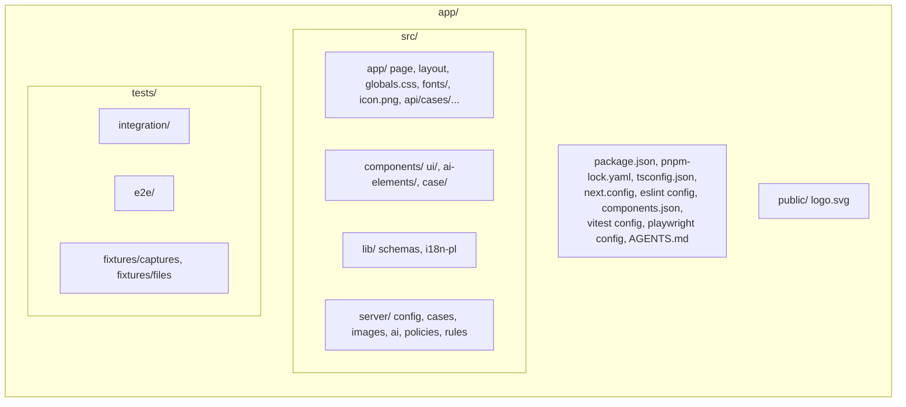

# ADR-001: Project Setup and Initialization

**Date:** 2026-11-25
**Status:** Accepted
**Relates to:** `docs/ADR/000-main-architecture.md`
**Amended by:** [ADR-005](005-amendments.md): A7, A14, A17, A20, A21. Where this ADR differs, ADR-005 wins.

---

## 1. Scope

How the implementing agent turns the empty `app/` folder into a working Next.js 16 + TypeScript strict project with pnpm, Tailwind 4, shadcn/ui, AI Elements, AI SDK 7, the OpenRouter provider and the test tooling. Covers commands, flags, the order of steps, configuration decisions and the verification of a clean scaffold.

Not covered here: application code (ADR-002 to ADR-004).

---

## 2. Technology Documentation References

| Library | Context7 ID or official docs | Used for |
|---|---|---|
| Next.js / create-next-app | `/vercel/next.js/v16.4.5` | Scaffold flags, App Router, route handlers |
| shadcn/ui CLI | `/shadcn-ui/ui` | `shadcn init` with presets, adding components |
| AI Elements | `/vercel/ai-elements` | Chat components registry |
| AI SDK | `/vercel/ai` | `ai`, `@ai-sdk/react` |
| OpenRouter provider | `/openrouterteam/ai-sdk-provider` | Model provider |
| pnpm | https://pnpm.io/motivation | Package manager, build-script approval |
| Vitest | https://vitest.dev/guide/ | Test runner |
| Playwright | https://playwright.dev/docs/intro | E2E |

---

## 3. Component Design

### 3.1 Preconditions (checked on the course VM, 2026-11-25)
- Node.js `v24.22.3` is installed. The provider needs ≥22.
- pnpm is **not** installed. Corepack `0.36.0` is available.
- `app/` contains only `README.md`, which holds the course checklist.

### 3.2 Initialization sequence

| Step | Action | Notes |
|---|---|---|
| 1 | Activate pnpm: `corepack enable pnpm`, then `pnpm -v` | If enabling needs root, use `corepack pnpm …` for every command, or install pnpm for the user only. Record the pnpm version in `package.json` `packageManager` (Corepack does this) |
| 2 | Move `app/README.md` out temporarily, e.g. to the scratchpad | `create-next-app` 16.4.6 refuses a target folder that contains `README.md`. Only `.git`, `.gitignore`, `LICENSE`, `docs`, `.vscode`, `.idea` and a few others are allowed |
| 3 | From the repo root run `pnpm create next-app@latest app` with the flags in 3.3 | Creates the project in `app/` without its own git repo |
| 4 | Restore the course checklist: merge the saved README content into the generated `app/README.md` and tick the items that are done | Keep the checklist; replace the generated boilerplate text with real start/test commands |
| 5 | Turn on extra TypeScript checks (3.4) | |
| 6 | `pnpm dlx shadcn@latest init -d` inside `app/` | `-d` = template `next`, preset `base-nova`. `--base-color` and `--style` no longer exist |
| 7 | Add shadcn components: button, card, radio-group, select, input, textarea, label, popover, calendar, dialog, badge, alert, skeleton, collapsible | Through `pnpm dlx shadcn@latest add …` |
| 8 | Add AI Elements components: conversation, message, prompt-input, loader | `pnpm dlx ai-elements@latest add <name>`, or `pnpm dlx shadcn@latest add https://elements.ai-sdk.dev/api/registry/<name>.json`. Do **not** install the whole registry |
| 9 | Runtime deps (3.5) with `pnpm add` | Pin majors: `ai@^7`, `@ai-sdk/react@^4`, `@openrouter/ai-sdk-provider@^3`, `zod@^4` |
| 10 | Approve native build scripts for `sharp` | pnpm blocks dependency build scripts by default. Allow `sharp` (`pnpm approve-builds`, or `onlyBuiltDependencies` in `pnpm-workspace.yaml` / `package.json`). **VERIFY** which one pnpm writes |
| 11 | Dev deps (3.6) and test config (3.7) | |
| 12 | Scripts (3.8), env files (3.9), brand assets (3.10) | |
| 13 | Verify the scaffold (Section 8) and commit `App: scaffold Next.js project` | Before any feature code |

### 3.3 `create-next-app` flags

| Flag | Value | Reason |
|---|---|---|
| `--ts` | on | TypeScript required |
| `--tailwind` | on | Tailwind 4 is required by AI Elements and shadcn |
| `--eslint` | on | Lint in the verification suite |
| `--app` | on | App Router required |
| `--src-dir` | on | Keeps `src/app`, `src/components`, `src/server`, `src/lib` apart from config files |
| `--import-alias "@/*"` | on | Matches the shadcn/AI Elements import path `@/components/...` |
| `--use-pnpm` | on | Team choice |
| `--disable-git` | on | `app/` is inside the existing repository |
| `--empty` | on | Minimal starting page with no demo content |
| `--agents-md` | on (default) | Creates `app/AGENTS.md`, the nested, stack-specific agent instructions recommended by the course |
| `--yes` | on | Non-interactive. Accepts the defaults: Turbopack and Cache Components enabled |

Defaults we keep:
- **Turbopack** for dev and build.
- **Cache Components**. Consequence: route handlers must **not** export `runtime`. Node.js is already the default runtime, `edge` is deprecated, and sharp needs Node.
- All four API routes are dynamic POST handlers and read request bodies, so they are never cached.

### 3.4 TypeScript configuration
- `strict: true`, generated by default. Must stay on.
- Also enable `noUncheckedIndexedAccess`, `noImplicitOverride` and `noFallthroughCasesInSwitch`.
- No `any` in application code. ESLint rule `@typescript-eslint/no-explicit-any` set to error.
- `moduleResolution` stays as generated (`bundler`). `file-type` and the provider are ESM-only, which this setting supports.

### 3.5 Runtime dependencies

| Package | Purpose |
|---|---|
| `ai` (^7) | AI SDK core |
| `@ai-sdk/react` (^4) | `useChat` |
| `@openrouter/ai-sdk-provider` (^3) | OpenRouter models + `decisionModel()` |
| `zod` (^4) | Schemas |
| `sharp` | Image compression |
| `file-type` | Magic-byte detection |
| `server-only` | Prevents server modules in client bundles |
| `react-hook-form`, `@hookform/resolvers` | Form state and zod validation (ADR-004) |
| `date-fns`, `@date-fns/tz` | Calendar-day arithmetic in `Europe/Warsaw` and the Polish locale for the date picker |

Dependencies added by shadcn/AI Elements (e.g. `streamdown`, `lucide-react`, `react-day-picker`) are accepted as generated.

### 3.6 Dev dependencies
`vitest`, `@vitejs/plugin-react`, `vite-tsconfig-paths`, `jsdom`, `@testing-library/react`, `@testing-library/user-event`, `@testing-library/jest-dom`, `@playwright/test`. Install the browsers with `pnpm exec playwright install chromium`.

### 3.7 Test configuration
- Vitest with two projects:
  - `unit`: node environment, for `src/server/**` and `src/lib/**`
  - `ui`: jsdom environment, for `src/components/**`
- Shared setup file registers the jest-dom matchers.
- Integration tests live in `tests/integration/**` and run in the node project.
- Playwright config:
  - `tests/e2e/`, `baseURL http://localhost:3000`
  - `webServer` runs `pnpm build && pnpm start`, so E2E tests the production build
  - Chromium desktop + one mobile viewport (360×800)
  - traces on failure
- Fixtures:
  - `tests/fixtures/captures/`: real API responses from the spikes
  - `tests/fixtures/files/`: synthetic non-image files for negative tests
  - Image tests reference `../assets/example-images/` directly; do not copy or modify those files.

### 3.8 `package.json` scripts

| Script | Command purpose |
|---|---|
| `dev` | Next dev server |
| `build` / `start` | Production build and server |
| `lint` | ESLint, 0 warnings allowed |
| `typecheck` | `tsc --noEmit` |
| `test` | Vitest run (unit + ui + integration) |
| `test:watch` | Vitest watch |
| `test:e2e` | Playwright on the real stack. Needs `OPENROUTER_API_KEY` and costs credits |
| `verify` | `typecheck` + `lint` + `test` + `build`. The pre-commit gate |

### 3.9 Environment files
- Extend the repo-root `.env.example` with the variables from ADR-000 Section 7. Keep `OPENROUTER_API_KEY=` empty.
- The app reads `app/.env.local`, which is gitignored. `create-next-app` already ignores `.env*`; check that `.env.example` is not ignored.
- `server/config` validates env with zod at first use and throws a clear startup error naming the missing variable. The value is never logged.

### 3.10 Brand assets
- Map `assets/design-tokens.json` to Tailwind 4 `@theme` variables in `src/app/globals.css`, following `docs/design-guidelines.md`.
- Map the shadcn CSS variables (`--primary`, `--background`, …) to the brand tokens so AI Elements inherits them.
- Copy the Geomanist fonts from `assets/fonts/geomanist/` into `app/src/app/fonts/` and load them with `next/font/local`.
- Copy `assets/logo.svg` → `app/public/logo.svg` and `assets/favicon.png` → `app/src/app/icon.png`.
- Set `<html lang="pl">`.

### 3.11 Nested agent instructions
Fill `app/AGENTS.md`, generated by `--agents-md`, with stack-specific rules only:
- the pnpm commands
- `pnpm verify` before commits
- "AI SDK v7: use Context7 `/vercel/ai`; do not use `toUIMessageStreamResponse`, `generateObject`, `image` parts"
- "no `runtime` export (Cache Components)"
- the location of prompts and captures

The root `AGENTS.md` stays generic.

---

## 4. Data Structures

None. This ADR defines tooling only.

---

## 5. Interface Contracts

| Interface | Contract |
|---|---|
| `pnpm verify` | Exit code 0 means: types, lint, all Vitest tests and the production build pass |
| `pnpm test:e2e` | Starts the production server, runs the Playwright suite and exits 0 on success. Skips the AI tests with a clear message when `OPENROUTER_API_KEY` is missing |
| Environment | Missing `OPENROUTER_API_KEY` → server routes fail with a startup error naming the variable. The page still renders |

---

## 6. Technical Decisions

### 6.1 Scaffold with `create-next-app`, not a template repository
**Status:** Accepted
**Date:** 2026-11-25
**Context:** We start from an empty `app/`. Candidates: `create-next-app`; the `vercel/chatbot` template; `assistant-ui init`; a Chat SDK starter.
**Decision:** `create-next-app@latest` with the flags in 3.3. Then `shadcn init`, then only the AI Elements components we use.
**Rejected alternatives:**
- `vercel/chatbot`: needs Postgres, Blob, Redis, Auth.js and AI Gateway, all out of scope (ADR-000 8.1).
- `assistant-ui init`: brings a different chat runtime (ADR-000 8.8).
- chat-sdk.dev: a bot SDK, not an app template.

**Consequences:**
- (+) Minimal, current, official baseline that includes `app/AGENTS.md`.
- (+) Nothing to delete.
- (-) We build the form and processing screens ourselves. They are small.

**Review trigger:** Auth or persistence move into scope.

### 6.2 Move `app/README.md` aside during scaffolding
**Status:** Accepted
**Date:** 2026-11-25
**Context:** The `create-next-app` 16.4.6 source does not allow `README.md` in the target folder.
**Decision:** Move it out, scaffold, then merge it back (step 2 and step 4).
**Rejected alternatives:**
- Scaffold into a temp folder and copy the files in: more file moves, and it is easy to miss dotfiles.
- Scaffold into a new folder name: breaks the agreed `app/` layout.

**Consequences:**
- (+) Standard command, no manual copying.
- (-) One extra step, which is documented here.

**Review trigger:** `create-next-app` allows README files in the target folder.

### 6.3 Keep Cache Components and Turbopack defaults
**Status:** Accepted
**Date:** 2026-11-25
**Context:** Next.js 16 enables both by default. With Cache Components, a `runtime` export is not allowed.
**Decision:** Keep both defaults. Do not export `runtime` or `maxDuration` from route handlers. Timeouts are enforced in our code (ADR-003).
**Rejected alternatives:** Disabling Cache Components. That moves away from the defaults with no benefit for four POST routes.
**Consequences:**
- (+) Default config, fewer surprises with current docs.
- (-) Some older examples (`export const runtime = 'nodejs'`) must not be copied.

**Review trigger:** A route needs an edge runtime, or caching causes stale responses.

---

## 7. Diagrams

### Initialization flow

### Resulting project layout

---

## 8. Testing Strategy

### Test scenarios for this area

| Scenario | Type | Input | Expected output | Edge cases |
|---|---|---|---|---|
| Scaffold builds | Verification | `pnpm verify` on the fresh scaffold | Exit 0, 0 warnings | Run once with `--frozen-lockfile` install to confirm the lockfile is consistent |
| Dev server starts | Manual / CLI | `pnpm dev`, open `/` with Playwright CLI | HTTP 200, empty page with Polish `<html lang="pl">`, no console errors | Port 3000 busy → use the next free port and record it |
| Vitest projects | Unit | One trivial passing test per project | Both `unit` and `ui` projects discovered and passing | jsdom matchers registered |
| Playwright smoke | E2E | Open `/` | Title and logo visible | Mobile viewport 360 px: no horizontal scroll |
| sharp installed | Unit | Resize a 10×10 generated buffer in a test | Succeeds | Fails if the pnpm build approval was skipped |
| ESM-only packages | Unit | Import `file-type` and the provider in server tests | No module format errors | |

### Technical acceptance criteria
- TAC-001-01: `app/package.json` declares `packageManager: pnpm@…`, `ai` major 7, `@ai-sdk/react` major 4, `@openrouter/ai-sdk-provider` major 3, `zod` major 4 and `next` major 16.
- TAC-001-02: `app/tsconfig.json` has `strict: true` and `noUncheckedIndexedAccess: true`. `pnpm typecheck` passes.
- TAC-001-03: `pnpm verify` exits 0 on the scaffold commit, and the counts of discovered and passed tests are recorded in the commit summary.
- TAC-001-04: No route handler exports `runtime`.
- TAC-001-05: `app/README.md` contains the restored course checklist and the real commands for dev, test, E2E and verify.
- TAC-001-06: `.env.example` lists every variable from ADR-000 Section 7, and `git check-ignore app/.env.local` confirms that the local env file is ignored.
