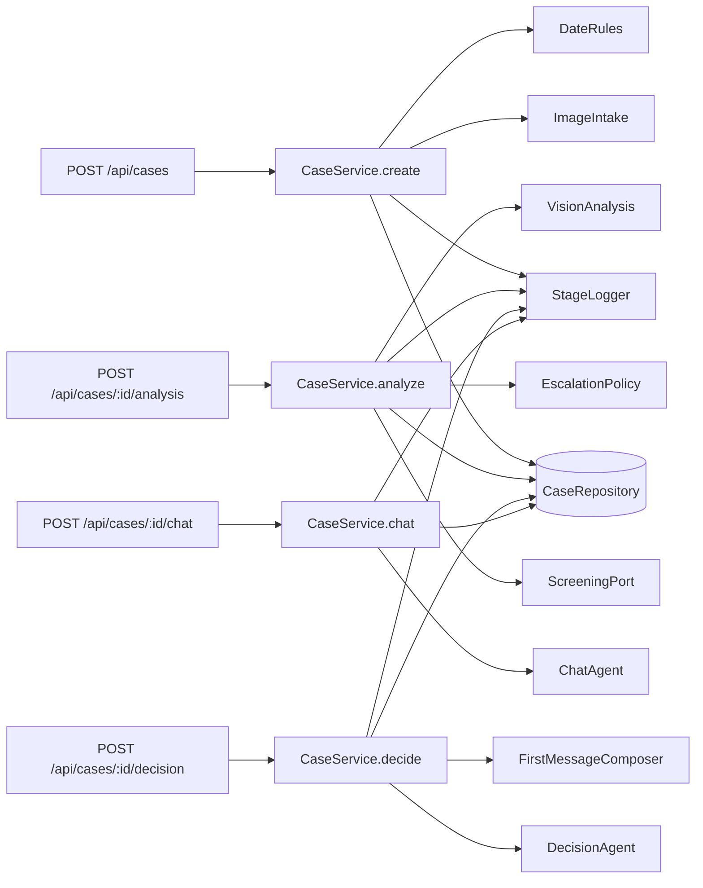
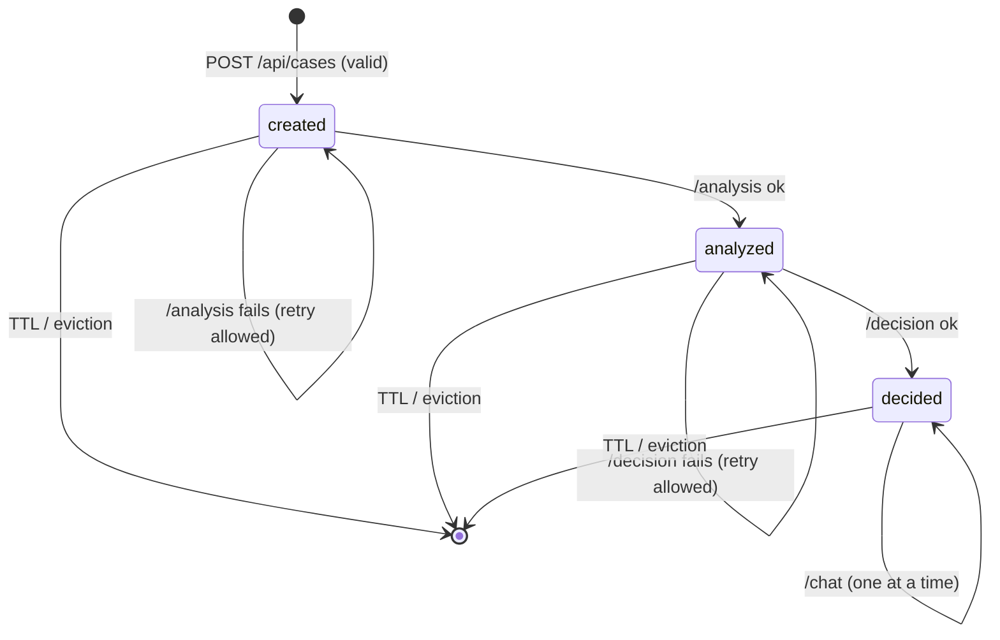
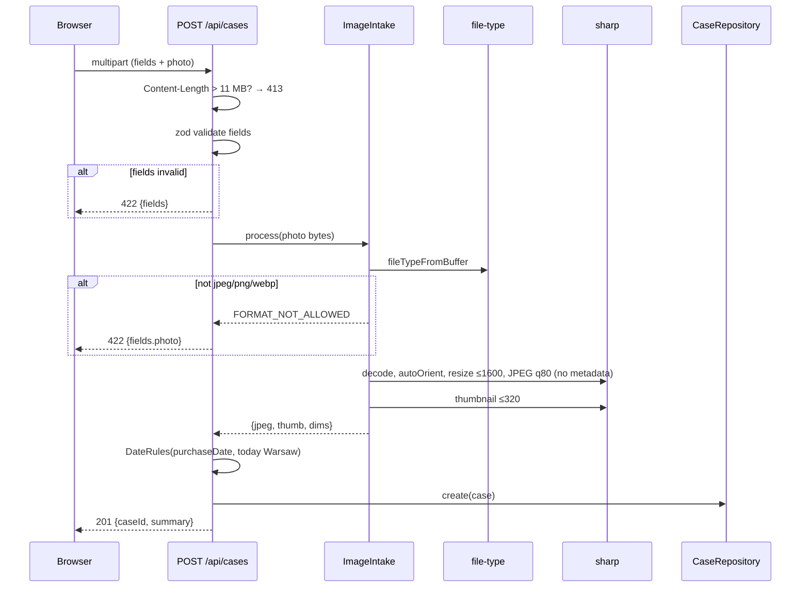

# ADR-003: Backend API, Case Store and Image Handling

**Date:** 2026-11-25
**Status:** Accepted
**Relates to:** `docs/ADR/000-main-architecture.md`, `docs/ADR/002-ai-pipeline.md`
**Amended by:** [ADR-005](005-amendments.md): A6, A7, A8, A16, A17. Where this ADR differs, ADR-005 wins.

---

## 1. Scope

This ADR covers the HTTP layer and server infrastructure:

- the four route handlers and their exact contracts
- request validation
- image validation, compression and thumbnail generation
- the in-memory case store
- case state transitions, idempotency and concurrency
- timeouts and error mapping
- logging

Not covered here: the AI logic behind the stage services (ADR-002) and the UI (ADR-004).

---

## 2. Technology Documentation References

| Library | Context7 ID or official docs | Used for |
|---|---|---|
| Next.js route handlers | `/vercel/next.js/v16.4.5` | `POST` handlers, `request.formData()`, dynamic params |
| AI SDK | `/vercel/ai` | `createUIMessageStreamResponse`, `UIMessage` type, `validateUIMessages` (VERIFY name in v7) |
| sharp | `/lovell/sharp/v0.35.5` | `autoOrient`, `resize` (`fit: inside`, `withoutEnlargement`), JPEG encode, metadata stripped by default |
| file-type | `/sindresorhus/file-type` | `fileTypeFromBuffer` |
| zod | https://zod.dev | Request schemas shared with the client |

---

## 3. Component Design

| Component | Responsibility |
|---|---|
| Route handlers (`src/app/api/cases/**/route.ts`) | Thin HTTP layer: parse input → call a service → map the result or error to a `Response`. No business logic |
| `CaseService` | Orchestrates the stages: `create`, `analyze`, `decide`, `chat`. Enforces state transitions, idempotency, budgets and logging |
| `CaseRepository` (interface) + `InMemoryCaseRepository` | `create`, `get`, `update`, `delete`, `sweepExpired`. Map on `globalThis`, TTL from `CASE_TTL_MINUTES`, max 500 entries with oldest-first eviction, lazy sweep on every access. Ready for a SQLite implementation later |
| `ImageIntake` | Size check, magic-byte format detection, decode check, compression, thumbnail |
| `ApiError` hierarchy | Typed errors with `code`, HTTP status and Polish message key |
| `StageLogger` | One JSON log line per stage (ADR-000 8.11) |

### 3.1 Case state machine

| From | Action | To | Notes |
|---|---|---|---|
| — | `POST /api/cases` | `created` | Form valid, image processed, date rule computed |
| `created` | `POST /analysis` succeeds | `analyzed` | Screening (+ escalation) stored |
| `created` | `POST /analysis` fails | `created` | Retry allowed. Partial screening is discarded |
| `analyzed` | `POST /analysis` | `analyzed` | Idempotent: returns the stored result, no AI call |
| `analyzed` | `POST /decision` succeeds | `decided` | DecisionRecord + first message stored |
| `analyzed` | `POST /decision` fails | `analyzed` | Retry allowed |
| `decided` | `POST /decision` | `decided` | Idempotent: returns the stored first message |
| `decided` | `POST /chat` | `decided` | One active chat request per case (`chatBusy`) |
| any | TTL expired / evicted | (gone) | All endpoints return 404 `CASE_NOT_FOUND` |

### 3.2 Image intake pipeline
1. Reject early when the `Content-Length` header is above 11 MB (10 MB file + multipart overhead): 413 `PAYLOAD_TOO_LARGE`.
2. Read the `photo` entry from the form data. Missing, or more than one file → 422 field error `photo`.
3. File size > 10 485 760 bytes → 422 `photo: FILE_TOO_LARGE`.
4. Run `fileTypeFromBuffer` on the bytes. Accept only `image/jpeg`, `image/png` and `image/webp`. Anything else → 422 `photo: FORMAT_NOT_ALLOWED`. The file name extension and the client MIME type are ignored (PRD AC-08).
5. Decode with sharp. A decode failure → 422 `photo: FORMAT_NOT_ALLOWED`. Images above 40 megapixels are rejected (`limitInputPixels`) with the same error.
6. Produce the AI image:
   - `autoOrient`
   - resize so the longer side is at most **1600 px**, `fit: inside`, no enlargement
   - JPEG quality 80
   - metadata stripped (the sharp default; never call `keepMetadata`/`withMetadata`)
7. Produce the thumbnail: longer side 320 px, JPEG quality 70, returned as a data URL.
8. Store the JPEG bytes, the dimensions, the detected original MIME type and the original size. The original upload buffer is discarded.

**1600 px, JPEG q80:** a fixed value large enough for fine scratches and small enough for fast uploads to the models. It applies to both the Decisions API and the vision model. This sets the limit that PRD AC-16 leaves to the ADR.

---

## 4. Data Structures

### 4.1 Case (stored)
- `id`: UUID v4 from `crypto.randomUUID`. `createdAt`, `expiresAt`: ISO timestamps.
- `status`: `created` | `analyzed` | `decided`.
- `form`: CaseForm (ADR-000 Section 5).
- `image`: `{ jpeg: bytes, width, height, originalMime, originalBytes }`. `thumbnailDataUrl`: string.
- `dateRule`: DateRuleResult (ADR-002 4.5).
- `screening`: ScreeningResult | null. `findings`: ImageFindings | null.
- `decision`: DecisionRecord | null. `decisionHistory`: DecisionRecord[].
- `messages`: UIMessage[]. The first element is the composed first message.
- `chatBusy`: boolean (with `chatBusySince`; a stale lock older than 90 s is released).

### 4.2 CaseSummary (returned to the client)
`caseType`, `category`, `productName`, `purchaseDate`, `thumbnailDataUrl`, `decision` (null until decided), `decisionLabel`.

### 4.3 Error body
`{ error: { code: string, message: string (Polish), fields?: { [fieldName]: string (Polish) } } }`.

### 4.4 Shared request schema (`lib/schemas/case-form`)
The same zod schema validates the client form and the server multipart fields:
- `caseType`: enum.
- `category`: enum of 9 keys: `smartphone`, `laptop`, `tablet`, `desktop`, `monitor`, `tv`, `audio`, `wearable`, `other`. Polish labels come from `lib/i18n-pl`.
- `productName`: trimmed, 2–100 characters.
- `purchaseDate`: ISO `YYYY-MM-DD`, not after today in `APP_TIME_ZONE`, not before 1990-01-01.
- `reason`: trimmed, ≤ 2000 characters. ≥ 10 characters when `caseType=complaint`.

---

## 5. Interface Contracts

### 5.1 `POST /api/cases`
- **Input:** `multipart/form-data` with the fields `caseType`, `category`, `productName`, `purchaseDate`, `reason` (optional), and one file field `photo`.
- **Output 201:** `{ caseId, summary: CaseSummary }`.
- **Errors:**
  - 413 `PAYLOAD_TOO_LARGE`
  - 422 `VALIDATION_FAILED` with a `fields` map. Messages: "Plik przekracza limit 10 MB", "Dozwolone formaty: JPEG, PNG, WebP", "Data zakupu nie może być z przyszłości", and the per-field required/length messages from `lib/i18n-pl`
  - 500 `INTERNAL`
- **Notes:** No AI call. The target response time is < 1 s for a 10 MB image (TAC-06).

### 5.2 `POST /api/cases/{caseId}/analysis`
- **Input:** none (empty body).
- **Output 200:** `{ status: "analyzed", findingsSource: "screening" | "llm", photoUsable: boolean }`.
- **Errors:**
  - 404 `CASE_NOT_FOUND`
  - 409 `CASE_STATE`, if called while another analysis for the same case is running
  - 502 `AI_UNAVAILABLE`
  - 504 `AI_TIMEOUT`

  502 and 504 both use the message "Nie udało się przetworzyć zgłoszenia. Spróbuj ponownie."
- **Notes:** Server budget 58 s. Idempotent once `analyzed`.

### 5.3 `POST /api/cases/{caseId}/decision`
- **Input:** none.
- **Output 200:** `{ status: "decided", decision, decisionLabel, citedRules, firstMessage: UIMessage }`.
- **Errors:** 404, 409 `CASE_STATE` (status is `created`), 502, 504. Messages as in 5.2.
- **Notes:** Server budget 58 s. Idempotent once `decided`.

### 5.4 `POST /api/cases/{caseId}/chat`
- **Input:** JSON `{ message: UIMessage (role user, a single text part of 1–2000 characters), trigger: "submit-message" | "regenerate-message" }`. The client builds this body with `prepareSendMessagesRequest` (ADR-004).
- **Validation:**
  - role must be `user`
  - only `text` parts are allowed; `file` parts are rejected (PRD AC-31)
  - trimmed length 1–2000
- **Idempotency:** if the user message ID already exists in `case.messages` and is the last message (no assistant reply after it, i.e. a retry after a failure), it is not appended again. Generation re-runs. If an assistant reply already follows it, return 409 `CASE_STATE`.
- **Output 200:** an AI SDK UI message stream, returned with `createUIMessageStreamResponse`. It contains `start`, optional `data-decision`, text parts and `finish`.
- **Errors before the stream starts:** 404, 409 (`chatBusy` or status ≠ `decided`), 422 `VALIDATION_FAILED`, 502.
- **Errors during the stream:** an error chunk whose text is the generic Polish message. The HTTP status stays 200 (ADR-002 3.5).
- **Notes:** `chatBusy` is set before the model call and cleared in `onFinish` / `onError` / abort.

---

## 6. Technical Decisions

### 6.1 Multipart upload to a route handler (not a Server Action)
**Status:** Accepted
**Date:** 2026-11-25
**Context:** We must accept 10 MB images. Server Actions default to a 1 MB body limit, which includes the multipart overhead. No route handler body limit is documented for Next.js 16.
**Decision:** Use `POST /api/cases` with `request.formData()`, plus our own header and size checks. Spike S3 confirms that a 10 MB upload works in `dev` and `start`.
**Rejected alternatives:**
- Server Action with a raised `bodySizeLimit`: it mixes the upload with RSC concerns and is harder to test as plain HTTP.
- Client-side compression only: the PRD requires the backend to compress, and the client cannot be trusted.

**Consequences:**
- (+) Plain HTTP that is easy to test with `Request` objects.
- (-) If S3 finds a limit, we need config. It would be documented in `app/AGENTS.md`.

**Review trigger:** S3 fails, or deployment moves behind a proxy with its own limits.

### 6.2 Content-based format detection plus sharp decode
**Status:** Accepted
**Date:** 2026-11-25
**Context:** `assets/example-images/laptop-1.png` is JPEG data with a `.png` name (PRD AC-08). Spoofed or corrupt files must be rejected.
**Decision:** Magic bytes decide the format (`file-type`). A successful sharp decode confirms the file is a real image.
**Consequences:**
- (+) Correct handling of mislabeled files.
- (+) Corrupt files are rejected.
- (-) Two libraries. Both are small and maintained.

**Review trigger:** HEIC support is requested.

### 6.3 Errors never leak technical details
**Status:** Accepted
**Date:** 2026-11-25
**Context:** PRD AC-36 forbids status codes, provider names and stack traces in customer-facing messages.
**Decision:**
- All thrown errors are mapped centrally to `ApiError` with a Polish message.
- Unknown errors become 500 `INTERNAL` with "Wystąpił nieoczekiwany błąd. Spróbuj ponownie."
- Technical details go to the server log only.

**Consequences:**
- (+) Consistent UX.
- (+) Testable mapping.
- (-) Debugging needs the server logs.

**Review trigger:** A staff/debug view is added.

---

## 7. Diagrams

### Route handler to service mapping


### Case state diagram


### Upload and validation sequence


### Chat request handling, including retry
```mermaid
sequenceDiagram
    participant UI as useChat
    participant H as POST /chat
    participant RP as CaseRepository
    participant CA as ChatAgent

    UI->>H: {message, trigger}
    H->>RP: get(case)
    alt not found
        H-->>UI: 404
    else chatBusy or status != decided
        H-->>UI: 409
    else
        H->>H: validate message (user, text only, 1–2000)
        H->>RP: append message unless it is a retry of the last message; set chatBusy
        H->>CA: stream(case, message)
        CA-->>UI: UI message stream (data-decision?, text...)
        CA->>RP: onFinish: append assistant message, clear chatBusy
    end
```

---

## 8. Testing Strategy

### Test scenarios for this area

| Scenario | Type | Input | Expected output | Edge cases |
|---|---|---|---|---|
| Valid create | Integration | multipart with `phone-1.jpg`, return, valid fields | 201, `caseId` is a UUID, summary echoes the fields, thumbnail data URL starts with `data:image/jpeg` | `laptop-2.webp`, `laptop-1.png` (JPEG bytes) also 201 |
| Field validation | Integration | each field invalid in turn | 422 with exactly that field in `fields` and the Polish message | Complaint with 9-character reason → 422; return with empty reason → 201 |
| Future date | Integration | purchaseDate = tomorrow (Warsaw) | 422 "Data zakupu nie może być z przyszłości" | Today → ok |
| File too large | Integration | synthetic 10 485 761-byte buffer with a JPEG header | 422 `FILE_TOO_LARGE` | Content-Length 12 MB → 413 before parsing |
| Spoofed format | Integration | a text file named `photo.jpg` | 422 `FORMAT_NOT_ALLOWED` | Truncated JPEG → 422 |
| Compression | Unit | `laptop-1.png` (3024×3135) | Output JPEG, longer side 1600, no EXIF in the metadata read-back | Small `phone-2.jpeg` (387×516) not enlarged |
| State transitions | Integration | `/decision` before `/analysis` | 409 `CASE_STATE` | `/analysis` twice → second call makes no AI call (mock call count 1) |
| Expiry | Unit | repository with a fake clock past TTL | `get` → null; route → 404 | Eviction at 501 cases removes the oldest |
| Chat busy | Integration | two concurrent chat requests | One streams, the other gets 409 | Stale lock > 90 s released |
| Chat retry | Integration | same user message ID sent twice after a failed first stream | Stored once, generation re-runs | Reply already exists → 409 |
| Chat rejects files | Integration | user message with a `file` part | 422 | — |
| Error mapping | Unit | AI timeout, AI 5xx, unknown error | 504 / 502 / 500 with Polish messages; the body contains no "OpenRouter", status code or stack | — |

### Technical acceptance criteria
- TAC-003-01: Every route handler file contains only parsing, a service call and response mapping. Business rules live in services (review check).
- TAC-003-02: A 10 MB upload succeeds with `pnpm start` (spike S3 + E2E), and a 10 MB + 1 byte upload fails with the Polish size message.
- TAC-003-03: All 4xx/5xx responses use the error body in 4.3, and no message contains English technical text.
- TAC-003-04: `/analysis` and `/decision` are idempotent: repeated calls after success make zero additional AI calls (asserted with mock call counts).
- TAC-003-05: After TTL expiry, all four endpoints return 404 `CASE_NOT_FOUND` for that case.
