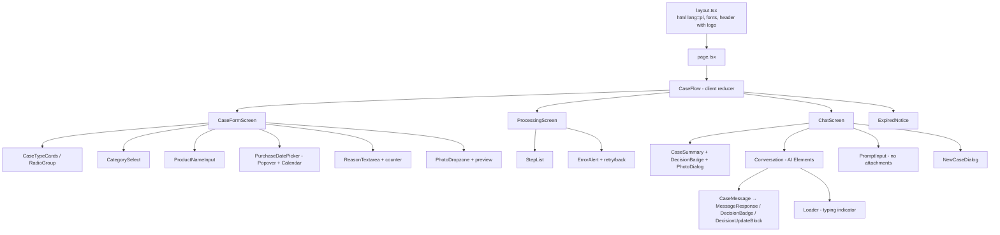
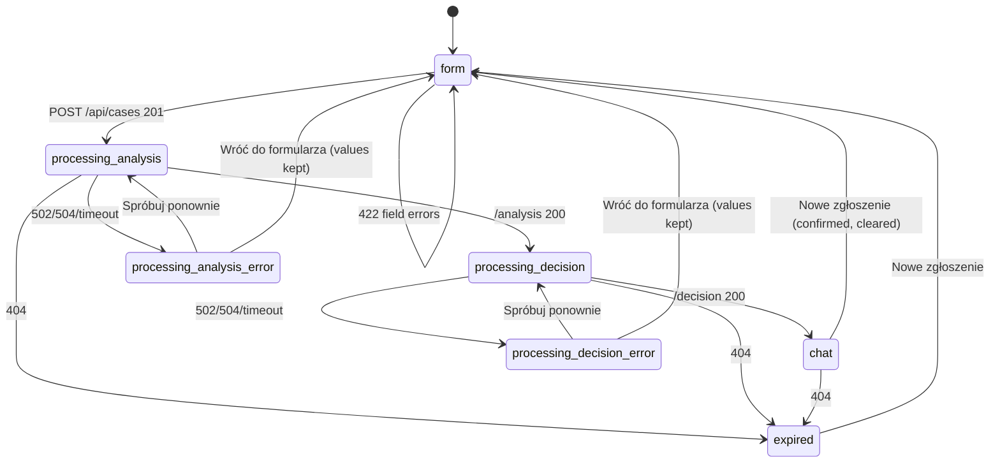
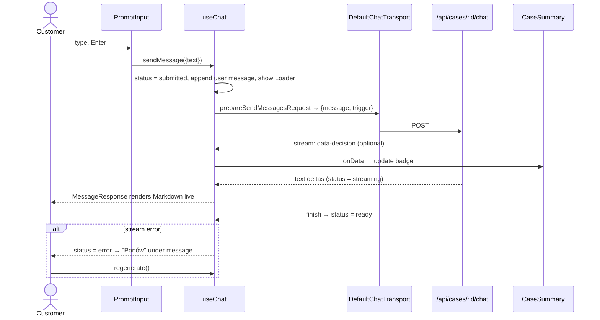

# ADR-004: Frontend — Screens, Client State and Chat UI

**Date:** 2026-11-25
**Status:** Accepted
**Relates to:** `docs/ADR/000-main-architecture.md`, `docs/ADR/003-backend-api.md`, PRD Section 9
**Amended by:** [ADR-005](005-amendments.md): A5, A6, A11, A13. Where this ADR differs, ADR-005 wins.

---

## 1. Scope

This ADR covers the browser side:

- the single-page client flow (form → processing → chat)
- form implementation and validation
- the processing screen and its calls
- the chat screen built from AI Elements + `useChat`
- rendering of the message parts, including decision blocks
- Polish UI strings
- accessibility and responsive behaviour
- applying the brand

Not covered here: the server logic (ADR-002/003) and project scaffolding (ADR-001).

---

## 2. Technology Documentation References

| Library | Context7 ID or official docs | Used for |
|---|---|---|
| AI SDK React | `/vercel/ai` | `useChat` (`messages`, `sendMessage`, `status`, `error`, `regenerate`, `onData`), `DefaultChatTransport` with `prepareSendMessagesRequest` |
| AI Elements | `/vercel/ai-elements` | `Conversation`, `ConversationContent`, `ConversationScrollButton`, `Message`, `MessageContent`, `MessageResponse`, `PromptInput` (+ textarea and submit sub-components), `Loader` |
| shadcn/ui | `/shadcn-ui/ui` | Form controls, Dialog, Popover + Calendar, Badge, Alert, Card, Collapsible |
| react-hook-form + resolvers | https://react-hook-form.com/docs | Form state, zod resolver, focus on the first error |
| Next.js | `/vercel/next.js/v16.4.5` | Page, layout, `next/font/local`, `next/image` for the logo |

---

## 3. Component Design

### 3.1 Page and client flow
`src/app/page.tsx` is a server component. It renders the layout shell (header with logo and title) and one client component, `CaseFlow`. There are no other routes. The URL does not change between steps, so reloading always lands on an empty form (PRD AC-32).

`CaseFlow` holds a reducer with these states:

| State | Data held | Screen |
|---|---|---|
| `form` | form values, the selected `File` + object URL, server field errors | `CaseFormScreen` |
| `processing` | `caseId`, summary, current step (`analysis` \| `decision`), error or null, form values kept for "back" | `ProcessingScreen` |
| `chat` | `caseId`, summary, the first message, current decision | `ChatScreen` |
| `expired` | — | Alert "Sesja zgłoszenia wygasła." + "Nowe zgłoszenie" |

| Transition | Trigger |
|---|---|
| `form → processing` | `POST /api/cases` returned 201 |
| `form → form` (with errors) | 422 from `POST /api/cases` (field errors mapped to inputs) |
| `processing(analysis) → processing(decision)` | `/analysis` 200 |
| `processing(decision) → chat` | `/decision` 200 |
| `processing → processing` (retry) | "Spróbuj ponownie": repeats the failed step only |
| `processing → form` | "Wróć do formularza": keeps values and photo. The next submit creates a new case |
| `chat → form` (empty) | "Nowe zgłoszenie" confirmed in the dialog |
| any → `expired` | A 404 `CASE_NOT_FOUND` from any case endpoint |

### 3.2 CaseFormScreen
- `react-hook-form` with the zod resolver, using the shared schema from `lib/schemas/case-form` with a client-side photo rule added.
- Validation runs on submit, and per field after it has been touched.
- On submit errors, focus moves to the first invalid field (PRD AC-11).

| PRD field | Component | Behaviour |
|---|---|---|
| Case type | shadcn `RadioGroup` styled as two large cards, Zwrot / Reklamacja, each with a one-line description | No default. Changing it toggles the reason label "(wymagane)" / "(opcjonalne)" and the helper texts for reason and photo immediately (AC-06) |
| Equipment category | shadcn `Select` | 9 options in the AC-03 order, Polish labels from `lib/i18n-pl` |
| Product name/model | `Input` | maxLength 100. The placeholder is an example, e.g. "np. Galaxy S24, ThinkPad X1" |
| Purchase date | `Popover` + `Calendar` (Polish locale, week starts Monday), trigger button shows the date as `dd.MM.yyyy` | Dates after today are disabled (AC-05). The value is stored as ISO `YYYY-MM-DD` |
| Reason | `Textarea` + live counter "n / 2000" | Hard max 2000 characters |
| Photo | Custom drop zone: a hidden `<input type="file" accept="image/jpeg,image/png,image/webp">` + a "Wybierz plik" button + drag and drop | Client checks size ≤ 10 MB and the browser MIME type. On failure, the AC-09 messages are shown and the file is not attached. A valid file shows a thumbnail (object URL), the file name and "Usuń". Choosing again replaces the file (AC-07). The server re-checks the real format |
| Submit | `Button` "Wyślij zgłoszenie" | Disabled while submitting (AC-12). Sends `multipart/form-data` with `fetch` |

### 3.3 ProcessingScreen
- On mount, runs `/analysis` and then `/decision` with `fetch`, each with `AbortSignal.timeout(62 000)`. This is a client backstop; the server answers within 58 s.
- Shows the two-step list ("Analizuję zdjęcie", "Przygotowuję decyzję"). The current step shows a spinner, completed steps a check mark (AC-23). The live region has `aria-live="polite"`.
- On error (502/504/timeout/network), shows an `Alert` with "Nie udało się przetworzyć zgłoszenia. Spróbuj ponownie." and two buttons, **Spróbuj ponownie** and **Wróć do formularza** (AC-34).
- Unmounting aborts the in-flight requests.

### 3.4 ChatScreen
- **Layout:**
  - `CaseSummary` panel at the top: case type, category, product, purchase date (`dd.MM.yyyy`), thumbnail, decision `Badge`.
    - Below 768 px width, it is a `Collapsible` with a one-line summary.
    - The thumbnail opens a `Dialog` with the full photo from the client's object URL.
  - The AI Elements `Conversation` fills the rest. A `PromptInput` sits at the bottom.
  - The header shows **Nowe zgłoszenie**.
- **`useChat` configuration:**
  - `id` = `caseId`.
  - `messages` = `[firstMessage]`: the seeded server message from `/decision`.
  - `transport` = `DefaultChatTransport` with:
    - `api` `/api/cases/{caseId}/chat`
    - `prepareSendMessagesRequest` returning the body `{ message: last message, trigger }`. Only the newest message is sent; the server holds the history (ADR-000 8.4).
  - `onData`: when a `data-decision` part arrives, update the summary badge (AC-30).
  - `onError`: log to the console in dev only. The UI shows the error state described below.
- **Sending:**
  - `PromptInput` without attachments (AC-31), textarea maxLength 2000.
  - Enter submits, Shift+Enter adds a new line (AC-27; check the default in spike S4 and adjust props if needed).
  - Empty or whitespace-only input cannot be submitted.
  - The submit button is disabled unless `status` is `ready` (AC-28).
- **Typing indicator:** while `status` is `submitted`, or `streaming` before the assistant message has visible text, render `Loader` in an assistant-side message bubble (AC-28).
- **Error state** (`status === "error"`):
  - Under the last user message, show "Nie udało się uzyskać odpowiedzi." with a **Ponów** button that calls `regenerate()` (AC-35).
  - The user message stays.
  - A 404 moves the flow to `expired`.
  - A 409 shows "Poczekaj na zakończenie poprzedniej odpowiedzi."
- **Scrolling:** `Conversation` sticks to the bottom while new messages arrive. `ConversationScrollButton` appears when the user scrolls up.
- **New case:** a `Dialog` with "Rozpocząć nowe zgłoszenie? Bieżąca rozmowa zostanie utracona.", **Anuluj** and **Rozpocznij nowe** (AC-33). Confirming resets the reducer to an empty `form`, revokes the object URLs and drops the `useChat` instance (remount via `key`).

### 3.5 Message part rendering (`CaseMessage`)

| Part | Rendering |
|---|---|
| `text` (assistant) | `MessageResponse` (streaming Markdown: headings, bold, lists) → no raw Markdown markers visible (AC-26) |
| `text` (user) | Plain text with preserved line breaks; never rendered as Markdown |
| `data-decision`, `origin=initial` | `DecisionBadge` in place (part order defined in ADR-002 4.4): label "Decyzja:" + coloured badge (Zaakceptowano / Odrzucono / Do weryfikacji przez pracownika), each with its own colour **and** icon, so colour is never the only signal |
| `data-decision`, `origin=chat_update` | `DecisionUpdateBlock`, always rendered **first** in its message even if it arrives after some text: heading "Zaktualizowana decyzja: {label}", the reason, and the disclaimer in italics |
| `reasoning`, `tool-*`, `file`, other | Not rendered |

Each assistant message has `aria-label="Odpowiedź asystenta"`. The decision badge text is readable by screen readers, not only its colour.

### 3.6 Polish UI strings
All visible strings live in `lib/i18n-pl`: labels, helper texts, placeholders, error messages, decision labels, the disclaimer and dialog texts. Components import keys from it and never hard-code text. The PRD quotes are used exactly. The module is shared with the server, so the decision labels and disclaimer are identical in both places.

### 3.7 Brand, layout and responsiveness
- Tokens and fonts as defined in ADR-001 3.10. Follow `docs/design-guidelines.md` for colours, typography, button styles and logo placement. Compare against `assets/homepage.png` during manual QA.
- Single column, max content width about 720 px for the form and chat.
- Works from a 360 px viewport with no horizontal scroll (AC-38).
- Touch targets are at least 44×44 px.
- Every control has a visible `<label>`. Errors are linked with `aria-describedby`, and invalid fields have `aria-invalid`.
- All flows can be completed with the keyboard: radio cards, select, calendar, file button, dialog focus trap (AC-39).

---

## 4. Data Structures

- **CaseFlowState:** see 3.1.
- **FormValues:** `caseType | ""`, `category | ""`, `productName`, `purchaseDate` (ISO or ""), `reason`, `photo: File | null`.
- **AppUIMessage:** `UIMessage` typed with metadata `{ decision?, origin?, citedRules? }` and the data part `decision: { decision, label, origin, reason? }`. Shared from `lib/schemas` so the server and client agree. Used as the generic type of `useChat` and validated with `dataPartSchemas`.
- **CaseSummary:** as in ADR-003 4.2. The client updates `decision` / `decisionLabel` from `data-decision` parts.

---

## 5. Interface Contracts

| Client action | Endpoint | Request | Success handling | Error handling |
|---|---|---|---|---|
| Submit form | `POST /api/cases` | `FormData` | Store `caseId` + summary → `processing(analysis)` | 422 → map `fields` to inputs, focus the first. 413 → photo error. Other → form-level Alert with the Polish message |
| Analysis step | `POST /api/cases/{id}/analysis` | empty | → `processing(decision)` | 502/504/timeout → error Alert with retry/back. 404 → `expired` |
| Decision step | `POST /api/cases/{id}/decision` | empty | → `chat` with `firstMessage` | Same as analysis |
| Send chat message | `POST /api/cases/{id}/chat` via `useChat` | `{ message, trigger }` | Stream rendered live | `status=error` → Ponów (`regenerate`). 404 → `expired`. 409 → info message |

---

## 6. Technical Decisions

### 6.1 One route with a client state machine
**Status:** Accepted
**Date:** 2026-11-25
**Context:** The PRD requires that reloading clears the case, and the chat must not be reachable without a fresh decision.
**Decision:** One page with a reducer-driven `CaseFlow`. There are no per-step URLs.
**Rejected alternatives:**
- `/case/[id]/chat` routes: deep links would point to cases that may have expired, and reload behaviour would need special handling.

**Consequences:**
- (+) Reload behaviour comes for free.
- (+) Simple tests.
- (-) No shareable URLs. Not needed in the PoC.

**Review trigger:** Persistent sessions are implemented.

### 6.2 react-hook-form + shared zod schema
**Status:** Accepted
**Date:** 2026-11-25
**Context:** Conditional validation (reason required for complaints), focus on the first error, and server/client parity.
**Decision:** Use react-hook-form with the zod resolver and the same schema the server uses. Server field errors are merged with `setError`.
**Rejected alternatives:**
- A Server Action form with `useActionState`: conflicts with the 1 MB default body limit (ADR-003 6.1), and inline per-field client feedback is weaker.
- Manual state: re-implements focus and dirty tracking.

**Consequences:**
- (+) One source of validation truth.
- (+) Accessible errors.
- (-) One more dependency.

**Review trigger:** The form grows into multiple steps.

### 6.3 Seed `useChat` with the server-composed first message
**Status:** Accepted
**Date:** 2026-11-25
**Context:** The first bubble must be the decision message (AC-24/25), and the agent must see it in its history (AC-29).
**Decision:** `/decision` returns the composed `UIMessage`. The client passes it as `useChat`'s initial `messages`. The server has already stored the same message as the first history entry.
**Consequences:**
- (+) The UI and the server history are identical from the first turn.
- (-) Depends on `useChat` accepting initial messages, which is documented. Spike S4 verifies it together with `prepareSendMessagesRequest`.

**Review trigger:** S4 shows initial messages are not sent or are re-sent incorrectly.

---

## 7. Diagrams

### Component tree

### Client state machine

### Chat send sequence (client side)

---

## 8. Testing Strategy

### Test scenarios for this area

| Scenario | Type | Input | Expected output | Edge cases |
|---|---|---|---|---|
| Field order and options | Component | render form | Fields in AC-01 order; 2 case types, none selected; 9 categories in AC-03 order | — |
| Conditional reason | Component | switch Zwrot ↔ Reklamacja | Label toggles "(opcjonalne)" / "(wymagane)" immediately; complaint submit with 9 characters → error | Return with empty reason → no reason error |
| Future date disabled | Component | open calendar | Tomorrow is disabled; today is selectable | — |
| Photo client checks | Component | 11 MB `File`, `text/plain` file, valid JPEG | Size error / format error / thumbnail + name + Usuń | Second valid file replaces the first |
| Focus on first error | Component | submit an empty form | Errors under every required field; focus on Case type | — |
| Double submit | Component | click submit twice quickly | One request (mocked fetch called once) | — |
| Server 422 mapping | Component | mocked 422 with `fields.photo` | Error shown under the photo; other values kept | — |
| Processing steps | Component | mocked fetch resolving in sequence | Step 1 spinner → check, step 2 spinner → chat | — |
| Processing retry/back | Component | `/decision` mocked 504 | Alert with both buttons; retry calls only `/decision`; back shows the filled form with the photo | — |
| First message rendering | Component | seeded first message (ADR-002 4.4) | Greeting, then the badge, justification heading, numbered steps, italic disclaimer; no `###` or `**` visible | Each decision shows a different icon/label |
| Decision update block | Component | assistant message with text then `data-decision` (`chat_update`) | Block rendered first with "Zaktualizowana decyzja: …" + disclaimer; summary badge updated | — |
| Input rules | Component | Enter / Shift+Enter / whitespace-only | Submits / new line / blocked | 2001 characters can't be typed |
| Busy state | Component | `status=submitted` | Loader visible, submit disabled | — |
| Chat error retry | Component | `status=error` | "Ponów" visible; click calls `regenerate` | — |
| New case dialog | Component | click Nowe zgłoszenie → Anuluj / Rozpocznij nowe | Stays / empty form | — |
| E2E happy path | E2E (real stack) | `phone-1.jpg`, return, purchase 3 days ago | Processing screen with both steps, then chat with a badge from the 3 labels, a disclaimer, ≥1 rule ID matching `R\d\.\d`; follow-up question "Jaka była data zakupu?" answered with the date in the reply | Do not assert which decision the model makes |
| E2E deterministic reject | E2E | return, purchase 30 days ago, `phone-3.jpeg` | Badge "Odrzucono", text contains "R1.1" | — |
| E2E validation | E2E | text file as photo; future date | Polish errors; no case created | — |
| E2E mobile | E2E | 360×800 viewport, whole flow | No horizontal scroll; summary collapsible | — |

### Technical acceptance criteria
- TAC-004-01: No string literal visible to users exists outside `lib/i18n-pl` (lint rule or review check). `<html lang="pl">` is set.
- TAC-004-02: The chat request body contains only `message` and `trigger`, never the whole history (asserted in a component test on the transport).
- TAC-004-03: `reasoning`, `tool-*` and `file` parts are never rendered.
- TAC-004-04: Every form control has an associated label, and keyboard-only completion of the full flow passes in Playwright (Tab / Enter / arrow keys only).
- TAC-004-05: Manual QA screenshots of the form, processing (including the error state), chat (each decision type seen) and the new-case dialog are taken with the Playwright CLI at 1280 px and 360 px and compared with `assets/homepage.png` and `docs/design-guidelines.md`.
