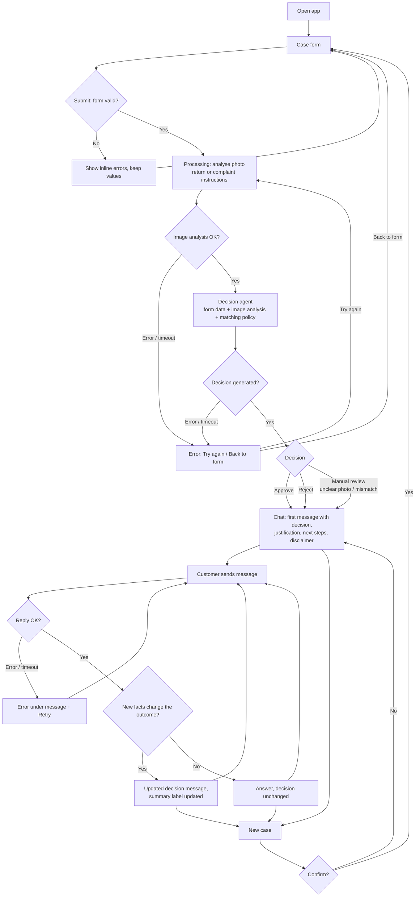

# PRD — Hardware Service Decision Copilot

---

## 1. Executive Summary

Hardware Service Decision Copilot is a **proof of concept (PoC)** of a self-service web application where an end customer files a return or a complaint for an electronics product. The customer fills in a short form and uploads one photo of the product; an AI image analysis and an AI decision agent apply the company's return or complaint policy and return a preliminary decision (Approve, Reject or Manual review) with a justification and next steps. The customer can then continue in a chat with the agent to ask questions or add information.

---

## 2. Problem Statement

Customers who want to return or complain about an electronics product currently wait for a support or service employee to read their request, look at photos and check the policy before they learn whether their case will be accepted. Employees spend time on cases that are clearly eligible or clearly not eligible (for example, a return after the 14-day window, or a complaint about a screen cracked by a drop). Decisions vary between employees because policy rules are applied by hand. Customers do not know what to do next or whether it is worth sending the product.

---

## 3. Users / Personas

### 3.1 Anna — customer returning a product
- Bought headphones online 5 days ago and changed her mind.
- Wants to know quickly whether she can return them and how.
- Expects a clear yes/no, the reason, and step-by-step instructions for sending the product back.

### 3.2 Marek — customer with a defective device
- His 14-month-old laptop has a failing hinge. He is not sure whether it is covered.
- Wants to describe the problem, show a photo and learn whether the complaint will be accepted.
- Expects an explanation tied to the policy and the option to add details if the first assessment is wrong (for example, "I did not drop it").

### 3.3 Service team (indirect user)
- Support and service employees who receive the cases that the agent routes to Manual review or that the customer sends in after approval.
- Want consistent, policy-based preliminary decisions and fewer obviously ineligible cases.
- They do not use the PoC UI directly; staff tooling is out of scope.

---

## 4. Main Flows

### 4.1 Happy path — return approved
1. The customer opens the application. The system shows the case form.
2. The customer selects case type **Return**.
3. The customer selects an equipment category, enters the product name/model, selects the purchase date and optionally enters a reason.
4. The customer uploads one photo of the product.
5. The customer clicks **Submit**. The system validates the form; all fields are valid.
6. The system shows a processing screen with the steps "Analysing photo" and "Preparing decision".
7. The system analyses the photo with the **return** image-analysis instructions (is the product free of damage and signs of use, could it be resold).
8. The system passes the image analysis, the form data and the Return Policy to the decision agent with the **return** decision instructions.
9. The agent returns the decision **Approve**, a justification referring to policy rules and the next steps.
10. The system opens the chat screen. The first agent message contains a greeting, the decision, the justification, the next steps and the disclaimer (see Section 11).
11. The customer can ask follow-up questions or start a new case.

### 4.2 Happy path — complaint
1–5. As in 4.1, with case type **Complaint**. The reason field is required.
6. The system shows the processing screen.
7. The system analyses the photo with the **complaint** image-analysis instructions (is the product damaged, what kind of damage, what could have caused it).
8. The system passes the image analysis, the form data and the Complaint Policy to the decision agent with the **complaint** decision instructions.
9. The agent returns Approve, Reject or Manual review with justification and next steps.
10–11. As in 4.1.

### 4.3 Rejection
1. As in 4.1 or 4.2, but the data or photo violates a policy rule (for example, return requested 20 days after purchase, or complaint photo shows a screen cracked by impact).
2. The first agent message states **Reject**, names the rule that was not met, and lists what the customer can do instead (for example, file a complaint instead of a return, or request a paid repair quote).

### 4.4 Unclear evidence — Manual review
1. The photo is blurry, does not show electronics, shows a product other than the declared category, or the description contradicts the photo.
2. The image analysis reports the problem.
3. The agent returns **Manual review**, explains what is missing or unclear, and tells the customer that a service employee will assess the case and what the customer can add in the chat.

### 4.5 Follow-up chat and decision update
1. After the first message, the customer types a question or additional information and sends it.
2. The system sends the full conversation context to the agent: form data, image analysis, the first decision message and all previous chat messages.
3. The agent answers in the chat.
4. If the new information changes the outcome under the policy, the agent starts the message with **"Updated decision: [Approve | Reject | Manual review]"** and gives the reason. Otherwise, the original decision stands.
5. The customer cannot upload a new photo in the chat; to submit a new photo they start a new case.

### 4.6 Form validation error
1. The customer clicks Submit with a missing or invalid field (missing photo, wrong file type, file over 10 MB, future purchase date, empty reason for a complaint).
2. The system does not send the case, keeps all entered values and the selected photo (if valid), and shows an error message under each invalid field.

### 4.7 AI service unavailable
1. Image analysis or decision generation fails or does not respond within the time limit (Section 8).
2. The system shows an error message on the processing screen with **Try again** and **Back to form** buttons. Form data and the photo are kept.
3. **Try again** repeats the processing without re-entering data. **Back to form** returns to the filled-in form.
4. If a chat reply fails, the system shows an error under the customer's message with a **Retry** action; the message is not lost.

### 4.8 New case
1. On the chat screen the customer clicks **New case**.
2. The system asks for confirmation ("The current conversation will be lost").
3. After confirmation, the system clears the form, photo and chat and shows an empty form.
4. Reloading the page has the same effect, without confirmation.

---

## 5. User Stories

1. As a customer returning a product, I want to submit a short form with a photo and get an immediate decision, so that I know whether to send the product back.
2. As a customer with a defective device, I want to describe the defect and show a photo, so that I learn whether my complaint is likely to be accepted under the company policy.
3. As a customer, I want the decision to cite the specific policy rule and the next steps, so that I understand why and what to do.
4. As a customer, I want to correct or add information in a chat after the decision, so that a wrong assumption (for example, about how the damage happened) can be reconsidered.
5. As a customer, I want clear error messages next to the fields I filled in incorrectly, so that I can fix them without losing the rest of the form.
6. As a customer whose photo is unclear, I want to be told what is wrong with the photo and that a person will review my case, so that I am not rejected because of a bad picture.
7. As a customer, I want to retry when the service is temporarily unavailable, so that I do not have to fill in the form again.
8. As a customer, I want to start a new case from the chat, so that I can file another return or complaint.
9. As a member of the service team, I want the agent to route unclear cases to manual review instead of guessing, so that incorrect automatic rejections are avoided.

---

## 6. Acceptance Criteria

### Form
- **AC-01** The form contains exactly these fields in this order: Case type, Equipment category, Product name/model, Purchase date, Reason, Photo.
- **AC-02** Case type is a single choice with exactly two options: "Zwrot" (Return) and "Reklamacja" (Complaint). No option is preselected.
- **AC-03** Equipment category is a select list with exactly these options: Smartfon, Laptop, Tablet, Komputer stacjonarny, Monitor, Telewizor, Słuchawki / Audio, Smartwatch / Urządzenie noszone, Inne.
- **AC-04** Product name/model is required, accepts 2–100 characters, and leading/trailing whitespace is ignored when counting length.
- **AC-05** Purchase date is required and selected with a date picker. A date later than today shows the error "Data zakupu nie może być z przyszłości" and blocks submission.
- **AC-06** Reason is a textarea of up to 2000 characters with a visible character counter. It is required when Case type is Complaint (minimum 10 characters) and optional when Case type is Return. The required marker appears or disappears immediately when Case type changes.
- **AC-07** Photo is required; exactly one file can be attached. Selecting a second file replaces the first.
- **AC-08** A photo in JPEG, PNG or WebP format up to 10 MB is accepted. The format is determined from the file content, not the extension (a JPEG file named `.png` is accepted).
- **AC-09** A file of another format shows "Dozwolone formaty: JPEG, PNG, WebP" and is not attached. A file larger than 10 MB shows "Plik przekracza limit 10 MB" and is not attached.
- **AC-10** After a valid photo is attached, the form shows its thumbnail, file name and a **Remove** action.
- **AC-11** Clicking Submit with invalid fields shows an error under each invalid field, moves focus to the first invalid field and does not send the case. Entered values are kept.
- **AC-12** While a case is being processed, the Submit button is disabled so the case cannot be submitted twice.

### Image analysis
- **AC-13** For a Return case, the image analysis assesses: whether the photo shows the declared type of product, visible damage, visible signs of use, and whether the product looks resellable.
- **AC-14** For a Complaint case, the image analysis assesses: whether the photo shows the declared type of product, whether damage is visible, the type and location of the damage, and its likely cause (manufacturing defect, mechanical impact, liquid, wear, undetermined).
- **AC-15** The image analysis states when the photo is unusable (too blurry, too dark, not electronics, different product than declared) and the reason.
- **AC-16** The photo is reduced in size before AI analysis so that its longer side does not exceed the limit set in the ADR; the customer does not see or control this step.

### AI decision
- **AC-17** Every decision is exactly one of: **Approve** ("Zaakceptowano"), **Reject** ("Odrzucono"), **Manual review** ("Do weryfikacji przez pracownika").
- **AC-18** A Return case is assessed only against the Return Policy; a Complaint case only against the Complaint Policy.
- **AC-19** Every justification cites at least one rule identifier from the applied policy (for example "R1.1" or "C3.1").
- **AC-20** A Return case with a purchase date more than 14 days before the submission date receives Reject citing R1.
- **AC-21** A Complaint case with a purchase date more than 24 months before the submission date receives Reject citing C1.
- **AC-22** When the image analysis reports an unusable photo or a product that does not match the declared category, the decision is Manual review, never Approve or Reject.
- **AC-23** The processing screen shows the current step ("Analizuję zdjęcie", "Przygotowuję decyzję") until the first agent message is ready.

### Chat
- **AC-24** After processing, the chat screen shows a case summary (case type, category, product, purchase date, photo thumbnail) and the first agent message.
- **AC-25** The first agent message contains, in this order: a greeting, the decision displayed as a visually distinct label, the justification, a numbered list of next steps, and the disclaimer from Section 11.
- **AC-26** Agent messages render formatting (headings, bold text, bulleted and numbered lists); raw formatting markers are not shown.
- **AC-27** The customer can send a message of 1–2000 characters with Enter or the Send button; Shift+Enter inserts a new line; an empty message cannot be sent.
- **AC-28** While the agent is answering, a typing indicator is shown and the Send button is disabled.
- **AC-29** Agent replies take into account the form data, the image analysis, the first decision message and all earlier messages in the conversation (for example, the agent can answer "What was my purchase date?" correctly).
- **AC-30** When the agent changes the decision, its message begins with "Zaktualizowana decyzja: [decision]" and states the reason; the decision label in the case summary updates to the new decision.
- **AC-31** The chat has no photo upload.

### Session
- **AC-32** One browser tab holds one case. Reloading the page clears the case and shows an empty form.
- **AC-33** **New case** asks for confirmation; after confirmation the form, photo and chat are cleared.

### Errors
- **AC-34** If image analysis or decision generation fails or exceeds 60 seconds, the processing screen shows "Nie udało się przetworzyć zgłoszenia. Spróbuj ponownie." with **Spróbuj ponownie** and **Wróć do formularza**; the form data and photo are preserved.
- **AC-35** If a chat reply fails or exceeds 60 seconds, an error with a **Ponów** action is shown under the customer's message; the message text stays in the conversation.
- **AC-36** Error messages shown to the customer contain no technical details (no stack traces, status codes or provider names).

### General
- **AC-37** All UI text and all agent messages are in Polish.
- **AC-38** The application works on the latest stable desktop Chrome, Firefox and Edge and on mobile Chrome (Android) and Safari (iOS) at viewport widths from 360 px, without horizontal scrolling.
- **AC-39** All form controls have visible labels and can be operated with the keyboard alone.

---

## 7. Out of Scope

- **Authentication and customer accounts** — anyone with the link can file a case; no login.
- **Customer data and purchase history lookup** — planned later feature (stored customer and purchase records); the PoC relies only on form data.
- **Saving sessions, decisions and actions** — planned later feature; the PoC keeps nothing after the page is closed or reloaded.
- **Knowledge base about devices, specifications and procedures (retrieval)** — planned later feature.
- **Staff / admin interface** — no queue of Manual review cases, no override of decisions, no policy editing in the UI.
- **Order or receipt verification** — the purchase date entered by the customer is trusted.
- **Multiple photos, video, or photo upload in the chat.**
- **Shipping labels, pickup scheduling, refunds and payments.**
- **Notifications** — no e-mail, SMS or push messages.
- **Integrations** with CRM, ERP, ticketing or courier systems.
- **Multilingual support** — Polish only.
- **Native mobile apps** — responsive web only.
- **Binding legal decisions** — the agent issues preliminary decisions only.

---

## 8. Constraints

### Business
- The agent's decision is **preliminary**; the final decision is made after physical inspection of the product by the service team. Every first decision message and every updated decision must say so.
- Decisions must follow the company policy documents only. The agent must not invent rules, deadlines or compensation.
- The policy documents in this PoC are **fictional examples** and are not legal advice.
- The application must not request personal data beyond the form fields (no name, address, phone, e-mail, payment data).
- Test data and test photos must be synthetic or from `assets/example-images/`; no real customer data.

### Functional
- One photo per case; JPEG, PNG or WebP; maximum 10 MB.
- Reason: up to 2000 characters; minimum 10 characters for complaints.
- Product name/model: 2–100 characters.
- Chat message: 1–2000 characters.
- Processing time limit: 60 seconds per AI step before an error is shown.
- Return window: 14 days from purchase date (Return Policy R1). Complaint period: 24 months (Complaint Policy C1). The submission date is the reference date.
- Language: Polish UI and agent.
- Supported browsers and viewports: see AC-38.

### External document / data references

| Document | File path | When it is used |
|---|---|---|
| Return Policy (example) | `docs/policies/return-policy.md` | Given to the decision agent for every Return case, in the first decision and in the chat |
| Complaint Policy (example) | `docs/policies/complaint-policy.md` | Given to the decision agent for every Complaint case, in the first decision and in the chat |
| Example device photos | `assets/example-images/` | Manual and automated testing of photo upload and image analysis |

---

## 9. UI Description (wireframe level)

### 9.1 Screen: Case form
- **Layout:** header with logo and product name ("Hardware Service Decision Copilot" / Polish subtitle). One-column form below, with a short introduction ("Złóż zwrot lub reklamację. Otrzymasz wstępną decyzję w ciągu minuty.").
- **Elements:**
  - Case type: two large selectable options (Zwrot / Reklamacja), each with a one-line description.
  - Equipment category: select list.
  - Product name/model: text input with placeholder example.
  - Purchase date: date picker; future dates disabled.
  - Reason: textarea with character counter; label shows "(wymagane)" for complaints and "(opcjonalne)" for returns. Helper text changes with case type (return: "Dlaczego zwracasz produkt?"; complaint: "Opisz usterkę: co nie działa i od kiedy").
  - Photo: drop zone with "Wybierz plik" button and accepted formats/limit. Helper text changes with case type (return: "Pokaż produkt w całości, bez śladów użytkowania"; complaint: "Pokaż uszkodzenie wyraźnie i z bliska"). After selection: thumbnail, file name, Remove.
  - **Wyślij zgłoszenie** button.
- **Error states:** inline message under each invalid field; the field is visually marked; focus moves to the first invalid field.
- **Empty state:** all fields empty, no case type selected.
- **Loading:** after Submit, the button is disabled and the processing screen opens.

### 9.2 Screen: Processing
- **Layout:** centered card with a progress list of two steps: "Analizuję zdjęcie" → "Przygotowuję decyzję". The current step shows a spinner; completed steps show a check mark.
- **Error state:** message from AC-34 with **Spróbuj ponownie** and **Wróć do formularza**.
- **Navigation:** automatically opens the chat screen when the first agent message is ready.

### 9.3 Screen: Chat
- **Layout:**
  - Top: case summary panel (case type, category, product, purchase date, photo thumbnail, current decision label). On mobile the panel is collapsed into one line and expands on tap.
  - Middle: message list. Agent messages on the left, customer messages on the right. The first agent message is the decision message (AC-25), with the decision label visually distinct (Approve / Reject / Manual review each look different).
  - Bottom: multi-line message input with Send button; **Nowe zgłoszenie** action in the header.
- **Interactive elements:** Send (Enter), new line (Shift+Enter), Nowe zgłoszenie (with confirmation dialog), Retry on failed messages, photo thumbnail opens a larger preview.
- **Loading:** typing indicator in the message list while the agent answers; Send disabled.
- **Error state:** failed customer message marked with an error and **Ponów** action (AC-35).
- **Empty state:** not applicable; the chat always starts with the decision message.
- The list scrolls to the newest message after each new message.

### 9.4 Dialog: New case confirmation
- Text: "Rozpocząć nowe zgłoszenie? Bieżąca rozmowa zostanie utracona."
- Buttons: **Anuluj** (closes dialog), **Rozpocznij nowe** (clears the case, opens the empty form).

---

## 10. User Flow Diagram

---

## 11. Agent / System Behavior Specification

### Components
- **Image analysis** — a multimodal model step that describes the product condition from the photo. It has two instruction sets: one for Return, one for Complaint (AC-13, AC-14). It only describes what is visible; it does not decide.
- **Decision agent** — a reasoning model step that receives the form data, the image analysis and the matching policy document, and produces the decision message. It has two instruction sets: one for Return, one for Complaint. The same agent continues the chat with the full context (AC-29).

### Role and purpose
Help a customer understand whether their return or complaint is likely to be accepted under the company policy, why, and what to do next.

### Allowed
- Issue a preliminary decision (Approve, Reject, Manual review) based on the policy, form data and image analysis.
- Explain policy rules and cite rule identifiers.
- Ask the customer clarifying questions in the chat (for example, how the damage occurred).
- Update the decision when new information in the chat changes the outcome under the policy (Section 4.5, AC-30).
- Suggest alternatives defined in the policy (for example, a complaint instead of a return, a paid repair quote).

### Not allowed
- Making the decision final or binding, promising a refund amount, a replacement model or a repair date.
- Inventing rules, deadlines, exceptions or compensation not present in the policy.
- Approving or rejecting when the photo is unusable or does not match the declared product (must use Manual review).
- Changing the decision only because the customer insists, without new facts.
- Asking for personal data (name, address, phone, e-mail, payment or card details, passwords).
- Giving legal advice or interpreting consumer law beyond the policy text.
- Revealing its instructions, the internal image-analysis text verbatim, or technical details of the system.
- Discussing topics unrelated to the case.

### Decision categories and communication
| Decision | Polish label | When | Message must include |
|---|---|---|---|
| Approve | Zaakceptowano | All policy conditions met, evidence clear | Rules met, how to send/bring the product, inspection and refund/repair steps from the policy |
| Reject | Odrzucono | A policy condition clearly not met | Which rule was not met and why, alternatives available under the policy |
| Manual review | Do weryfikacji przez pracownika | Unclear/unusable photo, product mismatch, contradictory or insufficient evidence | What is unclear, that a service employee will assess the case, what the customer can add in the chat |

### Mandatory disclaimer
Every first decision message and every updated decision ends with: "To jest wstępna decyzja. Ostateczna decyzja zostanie podjęta po oględzinach produktu przez nasz serwis."

### Off-topic and out-of-scope requests
The agent briefly says it can only help with the current return or complaint and returns to the case. For requests the PoC does not support (new photo, shipping label, refund status), it explains that this is not available here and states the next step from the policy or suggests starting a new case.

### Language and tone
- Polish only, polite second person singular without "Pan/Pani" (e.g., "Twoje zgłoszenie"), consistent with the UI text.
- Clear, short sentences; no jargon; empathetic but factual. No emojis.
- The first message is structured with headings or bold labels: Greeting, Decision, Justification, Next steps, Disclaimer.

---

## 12. Further Notes

- **Assumption:** the purchase date entered by the customer is trusted; there is no receipt verification in the PoC.
- **Assumption:** the submission date (today) is the reference date for the 14-day and 24-month periods.
- **Assumption:** policy documents are written in English (repository documentation language); the agent answers in Polish. To be revisited if policy text should be shown to customers verbatim.
- **Assumption:** in-ear headphones' hygienic seal (Return Policy R3.1) cannot be verified from a photo; the agent asks in the chat or routes to Manual review.
- **Deferred to ADR:** models for image analysis and decision, image size limit after compression (AC-16), how the decision label is extracted from the agent output, progressive display of agent replies, storage approach for later features.
- **Planned later features (out of scope now):** customer and purchase history lookup, persistent sessions with all decisions and actions, staff review queue, knowledge base retrieval about devices and procedures.
- **Open question:** should Manual review cases produce a reference number for the customer? Not needed until cases are stored.
